<p align="center">
  
</p>

<h1 align="center">Emigration</h1>

<p align="center">
  <em>People leave the places that fail them and move toward the places that thrive.</em><br>
  A population-migration and refugee mod for Sid Meier's Civilization VII.
</p>

<p align="center">
  <a href="https://github.com/tmtmiller1/civilizationvii-emigration/releases/latest"></a>
  <a href="https://steamcommunity.com/sharedfiles/filedetails/?id=3750554030"></a>
  
  
  <a href="LICENSE"></a>
</p>

<p align="center">
  <a href="https://steamcommunity.com/sharedfiles/filedetails/?id=3750554030"><strong>Subscribe on Steam</strong></a> ·
  <a href="https://github.com/tmtmiller1/civilizationvii-emigration/releases/latest"><strong>Download</strong></a> ·
  <a href="CHANGELOG.md">Changelog</a> ·
  <a href="README.pdf">Typeset PDF</a> ·
  <a href="#system-guide-and-feature-reference">Technical reference</a>
</p>

<p align="center">
  <a href="docs/steam-screenshots/01-dashboard-network.jpg">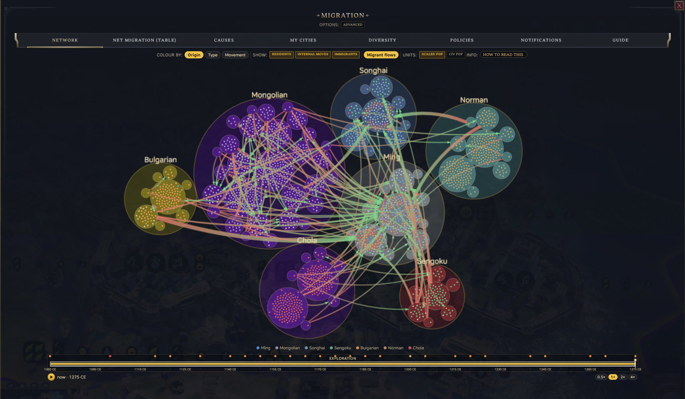</a>
</p>

When a settlement is starving, unhappy, or under siege, people leave. When one is thriving, people move there instead. *Emigration* adds migration and refugee systems to Civilization VII, moving population within and between civilizations and changing yields, growth, and Influence. Every move is logged with its cause.

Documentation on GitHub: [README.md](https://github.com/tmtmiller1/civilizationvii-emigration/blob/main/README.md) · [typeset PDF](https://github.com/tmtmiller1/civilizationvii-emigration/blob/main/README.pdf), with every formula rendered.

## What's new in 3.7.0

- The Settlements tab is a dashboard, and it opens first. Each of your settlements is one card with four panes:
  Arriving (where arrivals came from, which settlements this one attracts from, what would attract more), Leaving
  (the pressure to leave as a five-step gauge with its drivers, where people are pulled toward, what would keep them),
  Arrived (who lives here, the settlement's Mix and Character, its foreign community's standing) and Left (who is
  away, when they come home, the Hasten and Call from abroad buttons). A prosperity ledger between the panes lists
  every term of the score. Sort by pressure or by name; "All civilizations" has every civilization's cause cards and
  a table of its settlements. The Cities, Displaced, Communities, Causes, Net Migration and Guide tabs are folded
  into it or into the Network tab; the dashboard has four tabs: Settlements, Network, Policies, Notifications.
- People driven out of one of your settlements into another of yours come home on their own once it's calm, and
  settle the plot their people left. The Chronicle and a notice beside End Turn say when they start and when the
  last is back. Hasten pays to bring them sooner; Call from abroad is the paid gamble for people in another
  civilization's cities. Both are buttons on the card, with the full ledger on hover. A small reminder with a
  homecoming quote offers to open the tab once enough of your people are displaced and a home is calm.
- The city readout says what would stop people leaving ("+3 Food or +2 Happiness here (Granary gives +1 Food)") and
  what newcomers cost you a turn. A notice tells you when a civilization you've met opens or closes its borders.
- Spoil Guard: one checkbox hides civilizations you haven't met across the Emigration screens, with a red pill on the
  screen saying so, and it works together with the Demographics guard.
- Talent Attraction is +1 Science per 5 Population in every settlement (per 4 in the Modern Age) through the game's
  own yield system; Consular Protection carries +1/+2 Influence a turn the same way. Both cards name their numbers
  the way the game does, and the AI's planner can value them.
- The AI plays its side: a second city strategy ("hold your people") biases Production and Happiness when a
  settlement's Food stalls, AI civilizations get the free homecoming and pay the mod's prices with a discount for the
  game's difficulty, and they only pay to call people abroad.
- The Civilopedia's Emigration section describes all of this as it is now: the four-tab dashboard, Coming Home, the
  cards' current numbers, the Spoil Guard and the AI's part.

## What was new in 3.6.7

- Refugee rings stay on after the war or disaster ends, brightest while it's on, so the legend's ring always matches
  dots on the diagram.

## What was new in 3.6.6

- On the Network tab, hover a ringed refugee dot and the tooltip names the war it fled and where the person came
  from. The legend has a key for the ring.
- The war labels under each civ are off when the screen opens. Click "Event labels" next to "Migrant flows" to show
  them.
- Fixed: a civilization that fought more than one war had all its refugees ringed during the last one. Each refugee
  now belongs to the war going on when they arrived.

## What was new in 3.6.0

- Ten policy cards instead of twenty-two: the Pro-Immigration and Anti-Immigration stances in every age, and Talent
  Attraction and Consular Protection from the Exploration Age. A Pro-Immigration Stance now protects the enclaves in
  your cities and draws war and disaster refugees to you first; an Anti-Immigration Stance watches them. A game saved
  with one of the old cards slotted keeps it.
- Every card reads like the game's own: the yields first, then one line per effect with its number.
- Fixed: the stances' migration effects never applied in a running game. The game reports any card the age's data
  doesn't hold as slotted, so each stance came with a phantom opposite and the two cancelled. Only the yields paid.

## What was new in 3.5.0

- Policy cards for how a host treats the communities in its cities, in every age and open to every civilization. The protective cards (Guest Right, Charter of Communities, Equal Protection) give Influence, and an enclave you recognize while you're at war with its homeland is paid in full. The suspicion cards (Watched Quarters, Oaths of Loyalty, Registration of Residents) give Production in every city, but every enclave you recognize pays half and fewer immigrants arrive.
- Consular Protection, in the Exploration and Modern Ages: Influence each turn for every recognized enclave of your people in another civilization's cities. When a host slots a suspicion card, you hold grievances against it, once per host per age.
- City Details names an enclave's stage, Foothold, Established or Recognized, then says what the next step takes and what's holding it back. The enclave tooltip, the map marker and the Diversity table use the same names, and a new Civilopedia page, How an Enclave Grows, walks through them.
- An enclave goes with its settlement when the city is captured.
- With the Partisans mod running, people fleeing the fighting near an uprising are told as fleeing that uprising, and an enclave whose settlement burned in one gets its own Chronicle line.

## What was new in 3.4.0

- Notices appear in the game's notification train beside End Turn: an icon per kind of news, the text in its tooltip, and a click opens the Emigration screen. The old pop-up lines at the top of the screen are an Advanced setting.
- The call-home offer stops coming back every turn for people you chose to leave where they are.

## What was new in 3.3.1

- Settings survive a restart: the mod carries the Tower Settings Keeper, so Emigration's options keep their values from one launch to the next.

## What was new in 3.3.0

- Every language reads in full. The Civilopedia pages and their quotations, the enclave names and descriptions on the map, the call-home and arrival pop-ups, the enclave and displaced-people quotes, and the options that were still in English are translated into all eleven languages.
- Chinese, Japanese and Korean draw every character. Panel titles, city names, tabs, filter buttons, the guide and the network map's labels used the game's Latin-only faces and showed missing-glyph boxes; they now use the language's own font the way the game does. The network map's war badges draw their flag as a shape, not a glyph those fonts lack.
- Notifications and Chronicle entries read in your current language. New entries are recorded as text keys and composed when shown, so switching the game's language translates them; entries recorded before this version keep the text they were written with.
- The network timeline's labels are translated: the Scaled Pop and Civ Pop units, Play and Pause, the age name and the year labels.

## What was new in 3.2.1

- The city readout sits beside the City Details panel instead of over it. When you open a settlement, the per-city migration readout moves out from under whichever city-screen panel holds its corner, and returns to the corner when City Details is closed.

## What was new in 3.2.0

- A disaster only displaces people where it did damage: a settlement shielded from the event (a Dam or a Levee against a flood, the Khmer Baray) or one the event spared sends nobody, instead of every settlement in the radius taking the same distress.
- A flood reaches every settlement along its river, not just the ring of tiles around the epicenter the event names.
- Flood-like events from other mods are weighed as floods rather than as unknown events.

## What was new in 3.1.0

- Yields on the buttons: the refugee, newcomer, call-home and Cultural Enclave pop-ups show each choice's gains and costs on its own button, with the game's yield icons.
- Enclave stances pay a real sum once: Culture, Science, Influence or Gold, sized to your economy and the age, usually at a price in Gold; a stance you cannot afford is grayed out.
- Newcomers settled by the city show the yields of the tile they will work before you choose.

## What was new in 3.0.0

- Calling your people home is two offers: a purchase from your own settlements, and a gamble on your people abroad, each in three sizes with Gold and Influence prices.
- Reasons to stay: wonders and civic buildings hold people in a settlement, and emigration pressure fades once a settlement's troubles pass.
- The Ethnic Composition lens blends every people living on a tile, shades by how crowded it is, seats each enclave's people on its own tile, and repaints as soon as the turn starts.
- Migrants keep who they are: a mixed city sends out a mixed crowd, and razed settlements leave the lists at once.
- Enclaves explain themselves: hover an enclave's tile for its stage and the source of every yield; the map marker shows the stage.
- The Prosperity lens scores each tile in points and lists every term behind the score.
- The network diagram: click a city to see just its flows, or drag a settlement out of its civilization's circle.
- The Civilopedia covers the whole mod, with a page of quotations for every people.
- The Mods tab has a switch for each decision pop-up and full hover help on every option.

Full notes: [CHANGELOG.md](CHANGELOG.md).

## A note on the human reality behind this mod

Migration and displacement are abstracted here as game systems. In reality, people often leave home because of war, persecution, disaster, or hardship. This mod tries to acknowledge that reality without trivializing it.

I donated to the International Refugee Assistance Project while creating *Emigration*. I cannot sustain a per-subscriber pledge indefinitely, but I plan to mark major milestones with donations of time or money when I can. If you are able, please consider supporting UNHCR, the IRC, MSF, IRAP, or local refugee and mutual-aid groups.

### Subscriber milestones

- **100 subscribers:** Donated $100 to the International Refugee Assistance Project.
- **50 subscribers:** Donated $50 to Médecins Sans Frontières.
- **25 subscribers:** Donated $25 to the International Rescue Committee.
- **10 subscribers:** Pledged one hour of volunteer time to a refugee-support, humanitarian, or mutual-aid organization.
- **Release donation:** Made an initial donation to the International Refugee Assistance Project.

*Anonymized receipts will be added to the repository.*

## Features

Compatible with Civilization VII 1.5.0.

### Migration

- **Prosperity-based migration:** settlements are scored each turn on yields, happiness, war weariness, and government; population flows toward stronger settlements
- **Internal migration:** movement between a civilization's own settlements, shown separately on the dashboard
- **Cross-civilization migration:** shaped by borders, alliances, war, and asylum
- **Distance-weighted destinations:** nearby settlements are favored
- **Overcrowding pressure:** tall cities push population outward
- **Reasons to stay:** wonders and civic buildings (a granary, a market, walls, a school) hold people in a settlement, however large it is
- **Pressure that fades:** a settlement's urge to lose people follows its current situation, so a city that recovers from a siege or a bad stretch settles down again
- **Concurrent causes:** war refugees and economic migrants can leave the same city in the same turn
- **Migrant transit:** travel time scales with distance and game speed

### War and crisis

- **War refugees:** driven by district damage, sieges, and pillaging inside a city's borders
- **Aggressor-aware flight:** refugees prefer their own civilization, then neutrals, and avoid the attacker
- **Disaster and plague refugees:** floods, volcanoes, storms, and plague can force migration
- **Famine and unrest:** starvation and sustained unrest push people out
- **Crisis deaths:** prolonged siege, famine, war, or disaster can kill trapped populations
- **Displacement caps:** up to 60% of a city's population per siege and 50% per disaster
- **Resettlement time:** war and disaster refugees join the host population gradually; happy, open, uncrowded hosts settle them faster and pay upkeep while they wait
- **Refugee decisions:** rare choices to welcome refugees, settle them on the frontier, or turn them away; AI hosts make the same choice by a rule, at the same cost

### Real gameplay effects

- **Real departures:** each departure removes an outlying rural improvement and its yields; pillaged tiles go first, food tiles last during famine
- **Real arrivals:** place newcomers yourself, let the city place them, or use a Migrant unit
- **Integration cost:** temporary gold cost and delayed Celebration for the host civilization
- **Congestion headwind:** limits how much one settlement can absorb

### Diplomacy and policy

- **Pro-Immigration Stance:** +50% immigration, refugees come to you first, enclaves keep their full yields even at
  war, Influence, and Food in every city
- **Anti-Immigration Stance:** -60% immigration and -40% emigration, enclaves keep half their yields, Production in
  every city at a cost in Influence
- **Open Borders:** increases cross-civilization migration
- **Ten cards in all:** the two stances in every age, Talent Attraction and Consular Protection from the Exploration
  Age
- **Consular Protection:** Influence for your people's enclaves abroad, and grievances against a host that slots a
  suspicion card over them

### Identity and culture

- **Ethnic composition:** population tracked by civilization of origin, preserved through capture, and carried by migrants who move on, so a mixed city sends out a mixed crowd
- **Ethnic Composition lens (Shift+E):** tile-by-tile map of population origins, each tile a blend of the peoples living on it and shaded by how crowded it is; an enclave's tile reads as its people's own quarter
- **Integration:** newcomers assimilate over time; war with the homeland stops it and unrest slows it
- **Return migration:** diasporas can return to peaceful, prosperous homelands
- **The AI plays too:** AI civilizations choose their enclaves' stances, decide on refugees and call their people home from abroad through the same rules, at the player's prices less a discount for the game's difficulty; their displaced people come home on their own; and two city strategies ("keep them happy", "hold your people") have AI cities build against losing people
- **Coming home:** people driven out of one of your settlements into another of yours come back on their own once it's calm, and settle the plot their people left; Hasten pays Gold or Influence to bring them sooner, and Call from abroad is the paid gamble for people in another civilization's cities, each person asked answering at the odds shown
- **Cultural Enclaves:** lasting foreign communities can become real improvements with the origin civilization's identity and yields; hover an enclave's tile to see its stage and where each of its yields comes from
- **Put down roots:** enclave communities are less likely to return home
- **Migration Chronicle:** major movements become history entries
- **Quotes from the displaced:** refugee and newcomer pop-ups use words from that people's refugees, exiles, and migrants; the reminder that your people can come home uses words of those who longed for home and came back

### Interface

- **Migration dashboard:** a card per settlement with who is arriving, leaving, living here and away, what drives the pressure and what would stop it, and a prosperity ledger; every civilization's causes and settlements; the animated network diagram, where a click on a city highlights just its migrant flows and a settlement can be dragged out of its civilization's circle
- **Spoil Guard:** civilizations you haven't met stay hidden across the Emigration screens until you meet them; one checkbox, shared with the Demographics guard
- **Notifications in the game's own train:** the mod's notices sit beside End Turn as the game's do, plus a persistent log
- **Move attribution:** records the factor that decided each move
- **City readout:** pressure mix, reasons to leave and reasons to stay, what would stop people leaving, what newcomers cost, and enclave progress by settlement
- **Prosperity lens:** tile-by-tile prosperity map, each tile scored in points from what stands on it and around it, with a hover readout that lists every term
- **Demographics integration:** Net Migration, Emigration, and Immigration graphs and tables, with movement split into internal and external
- **Civilopedia section:** every system, every policy card, and every quotation with a note on its speaker

### Customization

- **Intensity presets:** Low, Medium, and High
- **Arrival behavior by type:** refugees, migrants, and returnees can ask where to settle or settle automatically; refugees ask by default
- **Decision pop-ups on or off:** refugee decisions, newcomer placement, displaced-people reminders, and enclave stances each have their own switch on the Mods tab
- **Hover help on every option:** each Mods-tab option explains what it does, what each choice means, and when a change takes effect
- **122 advanced options:** Options ▸ Mods ▸ Emigration
- **One game-setup option:** "Emigration: AI keeps cities happy" on the game setup screen, on by default, chosen for the whole game
- **Per-leader and per-civilization tuning:** all 38 leaders and 50 civilizations, including alternate personas
- **Game-speed scaling:** Online through Marathon
- **12 languages:** English, German, Spanish, French, Italian, Japanese, Korean, Polish, Portuguese (Brazil), Russian, Simplified Chinese, and Traditional Chinese

<h2 id="screenshots">Screenshots</h2>

<table>
  <tr><td width="50%" align="center" valign="top"><a href="docs/steam-screenshots/02-dashboard-net-migration.jpg">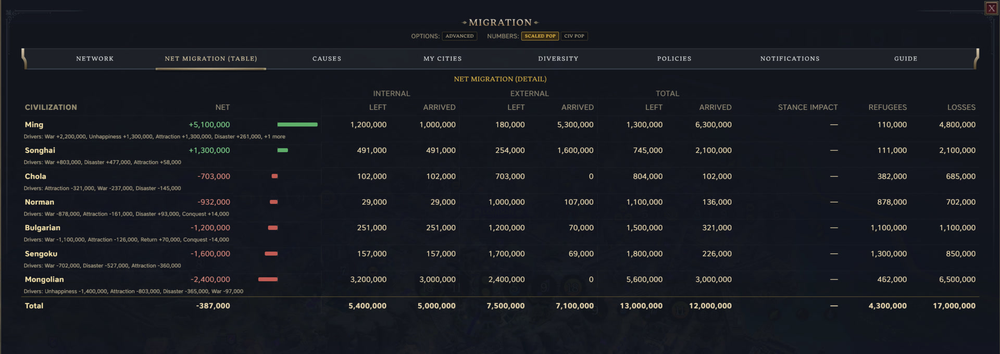</a><br><sub>Net Migration: internal and external movement for every civilization</sub></td><td width="50%" align="center" valign="top"><a href="docs/steam-screenshots/03-dashboard-causes.jpg">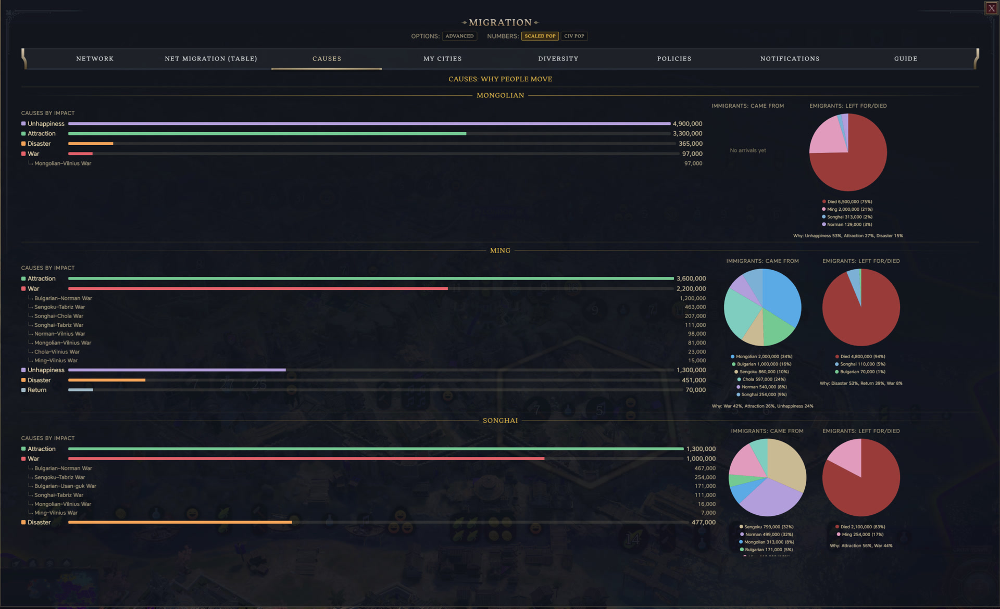</a><br><sub>Why people move: causes broken down by named war, disaster, and crisis</sub></td></tr>
  <tr><td width="50%" align="center" valign="top"><a href="docs/steam-screenshots/04-dashboard-diversity.jpg">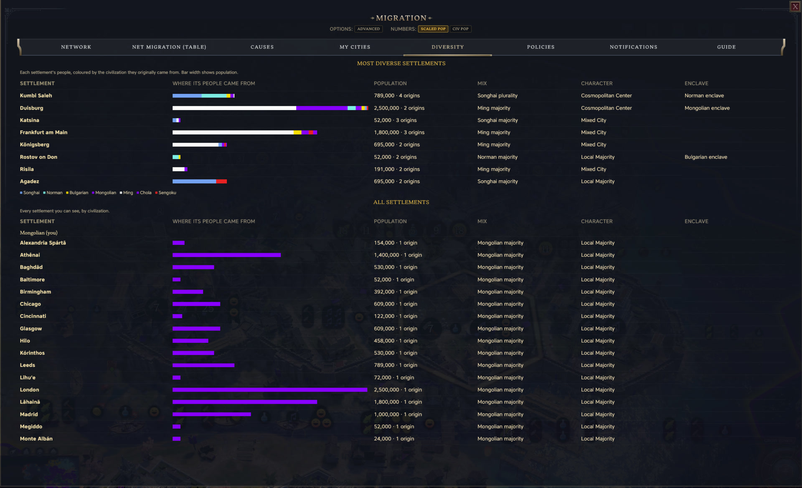</a><br><sub>Diversity: the most mixed settlements and every settlement's origins</sub></td><td width="50%" align="center" valign="top"><a href="docs/steam-screenshots/05-refugee-decision.jpg">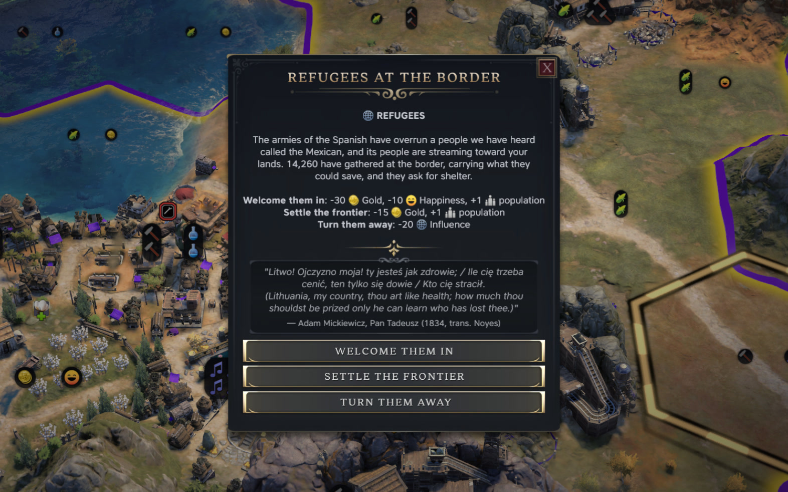</a><br><sub>A refugee decision after an upheaval, in the words of that people's own refugees</sub></td></tr>
  <tr><td width="50%" align="center" valign="top"><a href="docs/steam-screenshots/06-newcomer-placement.jpg">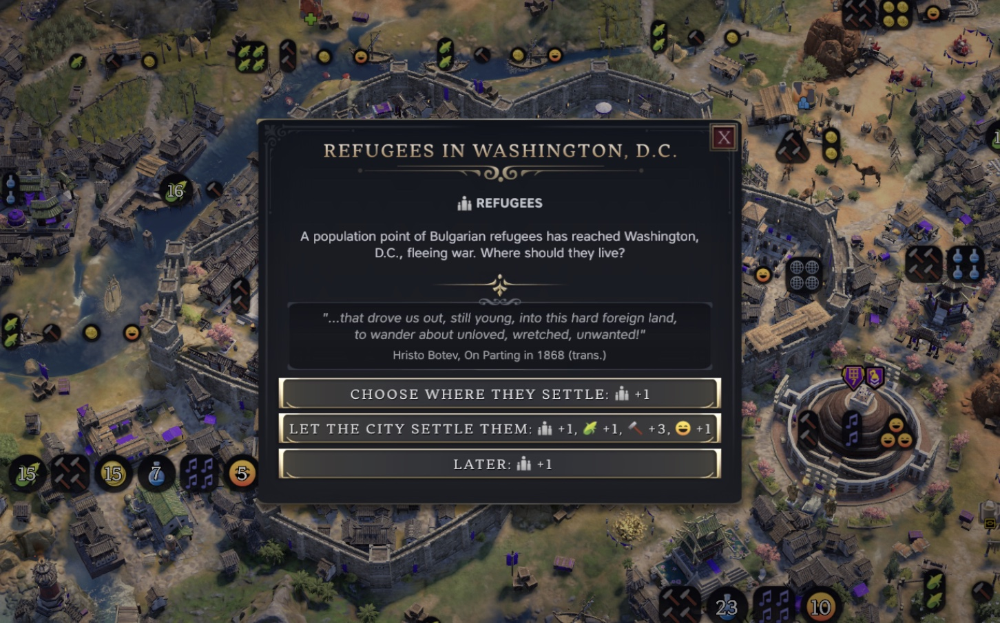</a><br><sub>Newcomers: choose where arrivals settle</sub></td><td width="50%" align="center" valign="top"><a href="docs/steam-screenshots/07-call-home-offer.jpg">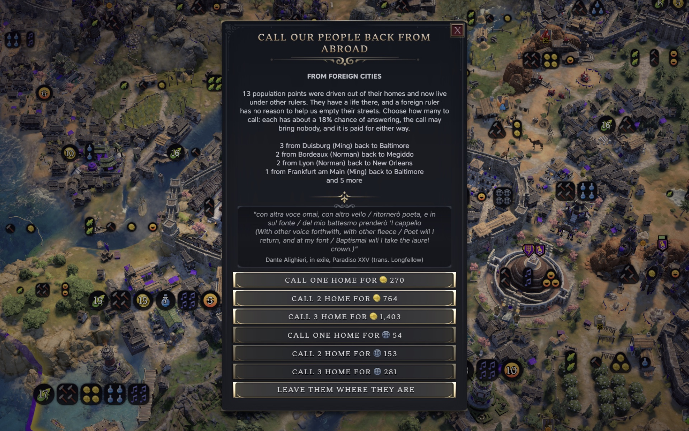</a><br><sub>Calling your people home: three sizes, priced in Gold or Influence</sub></td></tr>
  <tr><td width="50%" align="center" valign="top"><a href="docs/steam-screenshots/08-enclave-stance.jpg">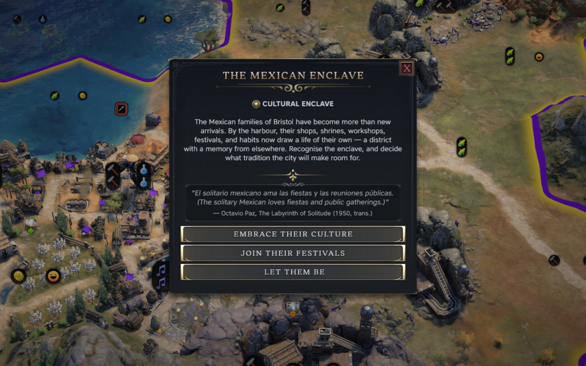</a><br><sub>A Cultural Enclave asks for your stance; each button shows what it pays</sub></td><td width="50%" align="center" valign="top"><a href="docs/steam-screenshots/09-enclave-on-map.jpg">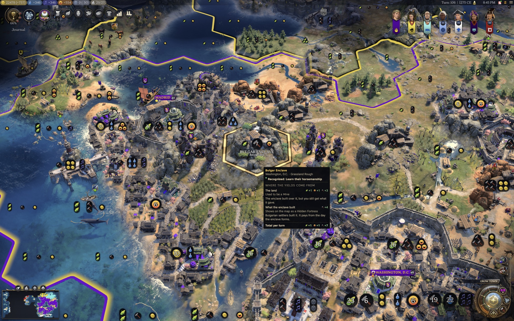</a><br><sub>A recognized enclave on the map, with its own tooltip</sub></td></tr>
  <tr><td width="50%" align="center" valign="top"><a href="docs/steam-screenshots/10-ethnic-composition-lens.jpg">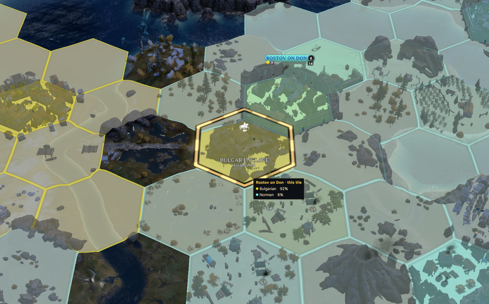</a><br><sub>The Ethnic Composition lens: Rostov on Don and its Bulgar Enclave</sub></td><td width="50%" align="center" valign="top"><a href="docs/steam-screenshots/11-prosperity-lens.jpg">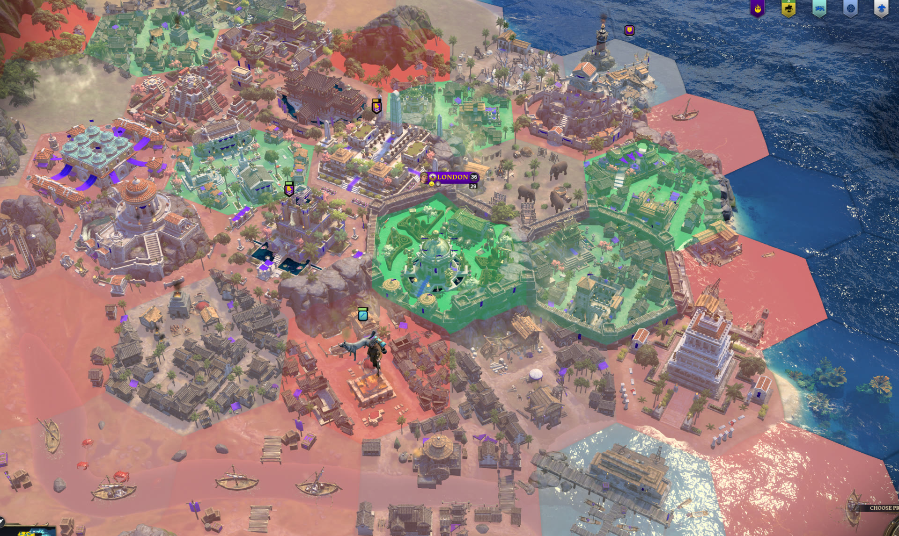</a><br><sub>The Prosperity lens: every tile scored in points</sub></td></tr>
  <tr><td width="50%" align="center" valign="top"><a href="docs/steam-screenshots/12-civilopedia-voices-rome.jpg">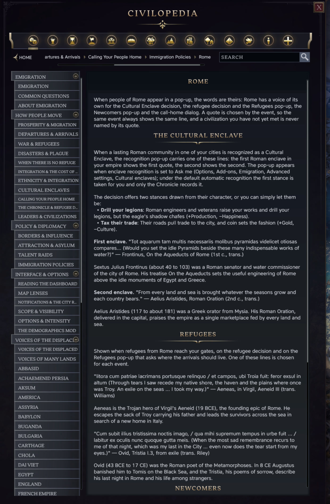</a><br><sub>Civilopedia: Voices of the Displaced, one page for every people</sub></td><td width="50%" align="center" valign="top"><a href="docs/steam-screenshots/13-civilopedia-departures-arrivals.jpg">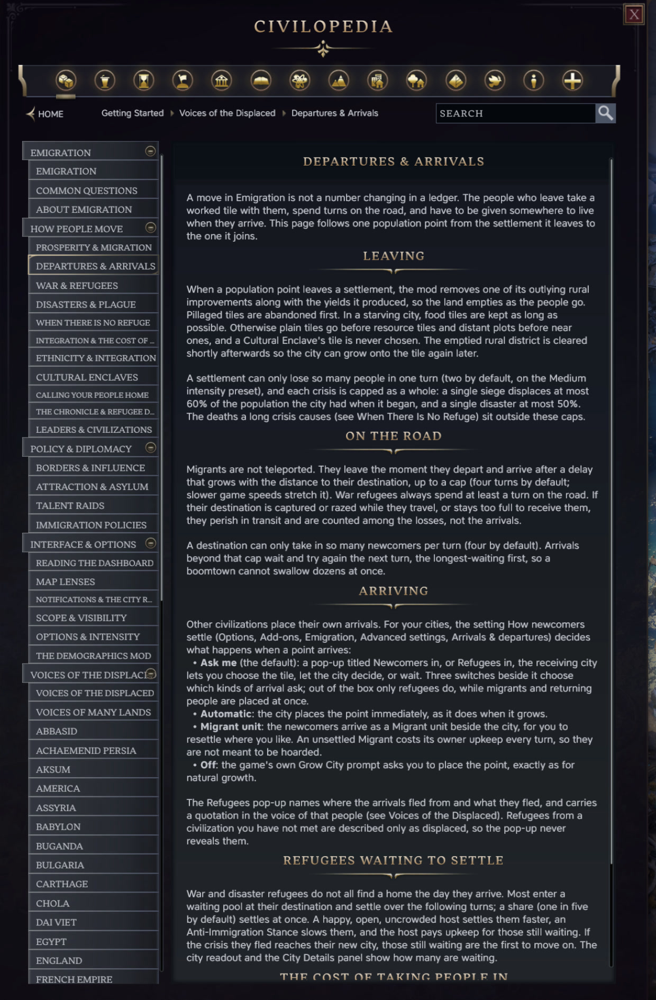</a><br><sub>Civilopedia: how departures and arrivals work</sub></td></tr>
</table>

## FAQ

### Why do people move?

- Settlements are scored each turn on yields, happiness, war weariness, and government. Lower-scoring settlements lose people to stronger ones.
- War damage, sieges, and pillaged tiles create refugees.
- Starvation, unrest, plague, disasters, and overcrowding also push people out.
- Causes run independently, so a city can lose war refugees and economic migrants in the same turn.
- What a settlement has built (wonders, and each kind of civic building) is a reason to stay, and it is not divided by population, so building well lets a large city hold its people.
- The pressure behind ordinary departures fades when a settlement's troubles pass, so only a strong, lasting reason to leave empties a city over time.

### Where do they go?

- Nearby settlements are preferred.
- War refugees prefer their own civilization, then neutral civilizations, and avoid the attacker.
- Cross-civilization movement is shaped by borders, alliances, war, asylum, immigration stances, and Open Borders.

### What does a move change?

- A departure removes an outlying rural improvement and its yields. Pillaged tiles go first; starving cities keep food tiles as long as possible.
- Migrants spend several turns in transit, depending on distance and game speed.
- Arrival behavior is configurable. Refugees can ask where to settle; migrants and returnees settle automatically by default.
- War and disaster refugees can spend additional time resettling after arrival. The host pays upkeep while they wait.
- Arrivals add a temporary gold cost and delay the next Celebration. Congestion limits intake.
- Sustained siege, famine, war, or disaster can kill people who cannot escape.
- One siege displaces at most 60% of onset population; one disaster at most 50%.

### How are identity and history tracked?

- Settlements track population by civilization of origin, including after capture. Migrants carry the mix of the city they left, so a diaspora that moves on keeps its identity.
- A conquered city the mod first sees after the conquest (added mid-game, or a save from before the ledger) counts as its original civilization's people.
- The Ethnic Composition lens (Shift+E) maps that composition by tile and repaints at the start of each turn, even while it is open.
- Newcomers integrate over time; war with the homeland stops integration and unrest slows it.
- Diasporas can return home when the homeland is peaceful and prosperous.
- Lasting foreign communities can form Cultural Enclaves. Enclaves persist while the community does and can be built over.
- Refugee decisions, displaced-person quotes, and the Migration Chronicle add narrative context.

### How do I see what is happening?

- The notification train and the Notifications log record each move and its cause.
- The dashboard's Settlements tab shows, for every settlement, who is arriving and leaving and why, who lives there and who is away, and what would change it; the Network tab shows the flows between civilizations.
- City readouts show local pressure, reasons to leave and to stay, what would stop people leaving, and enclave progress.
- Hovering an enclave's tile shows its stage and the source of every yield it brings in.
- The Civilopedia's Emigration section describes every system, policy card, and option, and lists every quotation with a note on its speaker.
- The Prosperity lens maps prosperity by tile: wonders, the center, buildings and quarters, worked land, rivers and natural wonders score up; ruin scores down. Hover a tile to see the terms.
- With Demographics installed, migration also appears in graphs and tables.

### What can I tune?

- Low, Medium, and High intensity presets plus individual options under Options ▸ Mods ▸ Emigration.
- Per-leader and per-civilization tuning.
- Automatic game-speed scaling from Online to Marathon.
- Interface text in 12 languages.

## Install & run

1. Copy this folder to `~/Library/Application Support/Civilization VII/Mods/emigration/`, relaunch, and enable **Emigration** in *Additional Content*.
2. Play turns. With `const DBG = true` (the dev default), the mod logs to `UI.log`:
   ```
   grep -E "EMIG_" "~/Library/Application Support/Civilization VII/Logs/UI.log"
   ```
   `release.sh` sets `DBG` to `false` for shipped builds.
3. **Dev dock buttons:** run a pass or dump the prosperity ranking. Console: `emigration.runNow()`, `emigration.rank()`, `emigration.window()`, `emigration.city(id)`.
4. **Tune or disable layers:** Options → Add-ons → Emigration → **Advanced settings**. All advanced-model and interactive-system switches default on.

Useful log markers: `EMIGRATION … left … for …`, `assimilation: …`, and `ATTRITION … (no refuge)`.

## Migration dashboard

Available through an optional dock button, a migration notice beside End Turn, or the Demographics interface. Four tabs: Settlements (a card per settlement, with every civilization's causes and settlements behind "All civilizations"), Network (the animated diagram, with the Net Migration table behind "Table"), Policies, and Notifications.

The dashboard reflects saved gameplay state, not cosmetic estimates: population, abandoned and settled tiles, gold, and Influence all change in game (§13).

### Documentation
- Player experience risks and mitigations: [docs/player-experience-risks.md](docs/player-experience-risks.md)
- Player experience items addressed: [docs/player-experience-addressed.md](docs/player-experience-addressed.md)
- Engine behavior recorded by in-game probes: [docs/engine-limits-from-probes.md](docs/engine-limits-from-probes.md)
- Tooltip compatibility with other tooltip mods: [docs/tooltip-mod-compatibility.md](docs/tooltip-mod-compatibility.md)
- Migration mechanics: [DESIGN.md](../../mod_ideas_tested/mods_research_and_analysis/emigration-docs/DESIGN.md)
- Engine checks and verification: [FINDINGS.md](../../mod_ideas_tested/mods_research_and_analysis/emigration-docs/FINDINGS.md)
- In-game validation: [testing-requirements.md](../../mod_ideas_tested/mods_research_and_analysis/emigration-docs/testing-requirements.md)
- Civ VII modding mechanics and limits: [civ7-mechanics-and-feasibility.md](../../mod_ideas_tested/mods_research_and_analysis/emigration-docs/civ7-mechanics-and-feasibility.md)
- Leader/civ ability and memento interactions: [leader-civ-memento-interactions.md](../../mod_ideas_tested/mods_research_and_analysis/emigration-docs/leader-civ-memento-interactions.md)
- Advanced migration formulas: [algorithmic-improvements.md](../../mod_ideas_tested/mods_research_and_analysis/emigration-docs/algorithmic-improvements.md)
- Interactive systems: [interactive-extensions-design.md](../../mod_ideas_tested/mods_research_and_analysis/emigration-docs/interactive-extensions-design.md), [interactive-extensions-implementation.md](../../mod_ideas_tested/mods_research_and_analysis/emigration-docs/interactive-extensions-implementation.md)

---

## System Guide and Feature Reference

*The overview ends here. The rest is the technical reference: systems, formulas, modules, tuning, and persistence.*

## Contents

1. [What it does (player-facing)](#1-what-it-does-player-facing)
2. [How it works: the per-turn loop](#2-how-it-works-the-per-turn-loop)
3. [The signals & the Prosperity score](#3-the-signals--the-prosperity-score)
4. [Population scaling (Demographics alignment)](#4-population-scaling-demographics-alignment)
5. [The advanced model (algorithms & per-civ tuning)](#5-the-advanced-model-algorithms--per-civ-tuning)
6. [Interactive systems (on by default)](#6-interactive-systems-on-by-default)
7. [Consequences: the gameplay-write cost layer](#7-consequences-the-gameplay-write-cost-layer)
8. [Reporting & Demographics integration](#8-reporting--demographics-integration)
9. [In-game feedback & notifications](#9-in-game-feedback--notifications)
10. [Options & tuning](#10-options--tuning)
11. [How the AI interacts with/plays the mod](#11-how-the-ai-interacts-withplays-the-mod)

*Appendices*

12. [Architecture / module map](#12-architecture--module-map)
13. [Runtime behavior in game](#13-runtime-behavior-in-game)
14. [Persistence](#14-persistence)
15. [Localization](#15-localization)
16. [Development](#16-development)
17. [Compatibility & mod coexistence](#17-compatibility--mod-coexistence)
18. [Known open issues](#18-known-open-issues)

---

---

## 1. What it does (player-facing)

Each turn, the mod scores settlements and moves population from weaker ones toward stronger nearby destinations.

- Peacetime: unhappy or low-yield settlements lose people to happier, wealthier ones.
- War refugees: district damage, siege, and pillaging cause rapid flight away from the nearest invader.
- Concurrent causes: war, disaster, and economic pressure are evaluated independently, so several can act on the same city in one turn.
- Cross-civilization: migration can stay within a civilization or cross borders.
- Regional: distance reduces pull, so nearby destinations usually win.
- Consequential: arrivals add integration costs and congestion, preventing unlimited growth.
- Speed-aware: pacing scales with game speed (§2).

Moves appear in toasts, Demographics graphs, and the dev log, for example:
`EMIGRATION 1 population point (≈30,000 people) left Rome (Romans) for Carthage (Carthaginians)`.

### Quick reference: what counts

Defaults are shown below; most are tunable in §10, and the Civilopedia's Emigration section carries the player-facing version.

**What makes people leave**

| | Counts? | |
|---|:---:|---|
| Unhappiness / low yields | ✓ | Main peacetime driver; happiness weighs most, with low per-capita yields adding pressure |
| Empire-wide war weariness | ✓ | Modest civ-wide pressure on top of local violence |
| War damage to districts | ✓ | More damage means more pressure |
| Being besieged or attacked | ✓ | Applies only to the affected city |
| Attacked by a city-state / Independent Power | ✓ | Same local conflict pressure as a major-civ war |
| Pillaged tiles in the city's borders | ✓ | Damaged improvements on the city's own plots |
| Starvation | ✓ | Most flee; some die until food recovers |
| Plague / disease | ✓ | Infected cities lose people; plague carry is optional |
| Natural disasters | ✓ | Capped per-city pressure, only where the event did damage |
| Overcrowding | ✓ | Tall cities push population outward |

**What attracts**

| | Attracts? | |
|---|:---:|---|
| Higher prosperity | ✓ | Weighted per-capita food, production, gold, science, and culture |
| Higher happiness | ✓ | Strongest factor, but capped by the shaped model |
| Pro-Immigration Stance | ✓ | Raises inbound pull, Influence and Food |
| Open Borders | ✓ | Cross-civ pull bonus |
| Being nearby | ✓ | Distance-penalized |
| What a settlement has built | ✓ | Wonders and each kind of civic building count as a reason to stay, not divided by population |

**Who participates**

| | Participates? | |
|---|:---:|---|
| Your civilization | ✓ | Sends and receives like any major civ |
| Towns | ✓ | Same system as cities |
| Your own settlements | ✓ | Internal migration shown separately |
| Other major civilizations | ✓ | Simulated from turn one |
| Unmet civilizations | ✓ | Simulated but masked in the UI by default |
| City-states / minor civs / Independent Powers | ✗ | Do not send or receive, though attacks by them can cause flight |

**Behavior**

| | | |
|---|:---:|---|
| Migration between civilizations | ✓ | Shaped by borders, distance, and stance |
| Distant AI-vs-AI wars | ✓ | Only when they damage, besiege, or pillage a city's own territory |
| Anti-Immigration Stance retains people | ✓ | More retention and Production, less Influence |
| No Open Borders reduces cross-civ flow | ✓ | Movement remains possible but is harder |
| Population and yields change | ✓ | Real gameplay writes |
| Pacing adapts to game speed | ✓ | Cooldowns, ramps, transit, and thresholds scale (§2) |
| Systems can be tuned or disabled | ✓ | Presets + 122 options, and one game-setup option |
| Fighting outside a city's borders | ✗ | Does not drive that city's emigration |
| Migrants arrive instantly | ✗ | Travel takes time |
| Absorbing migrants is free | ✗ | Temporary happiness/celebration and gold costs apply |
| War can empty a city to zero | ✗ | Displacement is capped; crisis deaths are separate |

**Identity, integration & return**

| | | |
|---|:---:|---|
| Settlements remember origins | ✓ | Composition by origin civ, preserved through capture |
| Migrants keep their identity | ✓ | A migrant carries the mix of the city they left |
| Newcomers integrate | ✓ | Non-owner origins drift toward the owner over time |
| War / unrest slows integration | ✓ | War with the homeland stops it; unrest slows it |
| Diasporas return home | ✓ | Possible when the homeland is peaceful and prosperous |
| Refugee waves can prompt a decision | ✓ | Welcome / frontier / turn away; an AI host decides by a rule |
| Migrations become history | ✓ | Migration Chronicle entries in Notifications |

**Scope & limits**

| | | |
|---|:---:|---|
| Replaces base-game files | ✗ | Additive only |
| Changes the AI | ✓ | Adds two city strategies ("keep them happy", an earlier and gentler copy of the game's own, a game-setup option on by default; "hold your people", Production and Happiness once a settlement's Food stalls); AI civilizations call people home from abroad, pick one of an enclave's two stances and decide on refugees through the mod's own rules, at a difficulty discount (§11) |
| Moves population instantly | ✗ | Distance and transit apply |
| Lets you place individual migrants | ✗ | You shape flows indirectly; local arrivals can be placed |
| Lets one civ snowball unchecked | ✗ | Field-relative scoring, congestion, and anti-snowball headwinds limit runaway inflow |

**Post-war recovery**

- **Will a war-shrunk city recover?** Usually. Displacement removes rural improvements, but the city and districts remain unless captured. Food growth and immigration can rebuild population after the fighting stops.
- **Do refugees return?** Some can through Return Migration (§6g) once the homeland is peaceful and prosperous.
- **Does repairing pillaged tiles restore population?** No. It removes pressure but does not add population.
- **How far can war shrink a city?** Displacement is capped at `siegeLossCapPct` (60% by default) of onset population. Crisis deaths are separate and can reduce rural population further.
- **Fastest recovery:** make peace, repair pillaged tiles, and raise happiness.

**Migration in transit**

Moves are delayed by `transitLagTurns`, scaled by distance and game speed.

- **Rate:** war and disaster refugees can flee every turn; voluntary migration is slower. Each civilization has its own budget.
- **Lifecycle:** departure removes the source rural point immediately. In transit, the migrant belongs to no city. Integration cost begins on arrival.
- **Per-city caps:** `maxLossPerCityPerTurn` and `maxGainPerCityPerTurn`, scaled by intensity. Deaths do not count against them.
- **Failed arrivals:** migrants wait if the destination is full. They can die in transit if the destination is razed, captured, or remains full.
- **Travel time:** typically 1–4 turns on Standard (`transitHexPerTurn` ≈ 5 hexes/turn); war/disaster refugees take at least one turn.
- **Reporting:** Emigration can rise before Immigration catches up. Net Migration counts only settled cross-civ moves.

---

## 2. How it works: the per-turn loop

On each `PlayerTurnActivated`:

1. **Per-civ costs** (`chargePerTurnCosts`) run for the active civilization: decaying integration cost and migrant-unit holding cost (§7).
2. **The emigration pass** (`runPass`) runs once on the local player's turn, gated by `turnInterval`:
   1. Decay violence and disaster distress.
   2. Build one `CitySignal` per simulated city (§3).
   3. Score and rank settlements by Prosperity (§3, §5).
   4. Advance state: scaling turn, cooldowns, and per-owner population totals used for congestion.
   5. Process each source on the voluntary and crisis tracks below. Each civilization has its own safety ceilings: `maxMovesPerTurn + movesPerCity × settlements` for voluntary movement and `movesPerSiege × cities in crisis` for crisis movement.
   6. Persist state to `GameConfiguration` and publish feedback (§9).
3. **Events** registered at boot update supporting state: `DiplomacyDeclareWar` / `MakePeace` maintain the aggressor map (§6a), while `RandomEventOccurred` records disaster distress (§6c).

### Two concurrent tracks: voluntary vs crisis (`splitTracksEnabled`)

Each source runs two independent tracks, so both can fire in the same turn:

- **Crisis** (war / disaster): can flee every turn, with no pressure bar or cooldown, bounded by `warSurgeMax` and `siegeLossCapPct`. Cause is *disaster* when disaster distress dominates; otherwise *war*.
- **Voluntary** (prosperity / unhappiness): builds pressure toward `emigrationBar`, moves one point when the bar is crossed, then waits `cooldownTurns`. Cause is *unhappiness* when happiness is low; otherwise *prosperity*. Pressure carries over each turn at `pressureRetention` (0.9, re-based for game speed; "Pressure kept each turn", Advanced ▸ Pacing), so it tracks the settlement's current situation in both directions, with a half-life of about 7 turns. A departure clears it outright, and settlements on a cooldown or with nowhere to go cool down too. At the default only a steady pull above about a third of the bar per turn reaches the bar; `pressureRetention = 1` keeps pressure indefinitely.

Each track has its own per-civ budget (`splitBudgetsEnabled`). Records still carry one cause each, so cause-level telemetry stays clean. The city readout can show the live mix, such as `"War 60% · Prosperity 40%"` (`splitUiReadoutEnabled`). All three flags default on.

If a severely distressed city has no viable destination, it builds attrition pressure and can lose a rural point as a death rather than a move (§6d).

### Game speed (all turn-based pacing scales, `gameSpeedTuningEnabled`)

Game speed changes how many turns cover the same game progress. The mod scales turn-based pacing with **S** so migration behaves similarly in game-time across speeds.

| Speed | CostMultiplier | S | cooldown 8 → | bar 30 → |
|---|---:|---:|---:|---:|
| Online | 50 | 0.5 | 4 | 15 |
| Quick | 67 | 0.67 | 5 | 20 |
| **Standard** | **100** | **1.0** | **8** | **30** |
| Epic | 150 | 1.5 | 12 | 45 |
| Marathon | 300 | 3.0 | 24 | 90 |

- **Durations ×S:** `cooldownTurns`, `siegeRampTurns`, `transitLagTurns`
- **Thresholds ×S:** `emigrationBar`, `attritionThreshold`
- **Decay re-based to `d^(1/S)`:** `violenceDecay`, `disasterDecay`
- **Not scaled:** `siegeLossCapPct`, intensity thresholds, yield weights, friction, or per-turn move ceilings

The active speed is read from `Configuration.getGame().gameSpeedType` and `GameInfo.GameSpeeds.lookup(...).CostMultiplier`, cached, and falls back to `S = 1` if unavailable. `gameSpeedTuningEnabled` is the rollback switch. See [`emigration-game-speed.js`](ui/emigration-game-speed.js). The separate `gameSpeedScalePopulation` flag is off by default and affects only the §4 representative-people scaling.

---

## 3. The signals & the Prosperity score

`emigration-cities.js` builds a `CitySignal` for each city: owner, population, rural and urban population, per-capita yields, happiness, unrest, starvation, siege state, war state, violence, disaster distress, and infection. `emigration-prosperity.js` converts that signal into a score. The legacy linear model is:

$$
\begin{aligned}
P &= \left(Q + h\,\lambda_h - n\,\lambda_n\right)\left(1 + \frac{s}{100}\right) + B, \\
Q &= \frac{f\,w_F + p\,w_P + g\,w_G + sc\,w_S + c\,w_C}{n^{\epsilon}}, \\
s &= v + d + \sigma + \tau + u.
\end{aligned}
$$

$P$ is prosperity, $Q$ per-capita productiveness, $h$ net happiness, $n$ population, and $s$ the combined situational percentage from violence, disaster, siege, starvation, and unrest. $\epsilon$ is `popExponent` (0.85, "Size dilutes prosperity"): below 1 it softens the per-head average, so a settlement's size divides away less of what it produces; 1 is a straight average.

$B$ is the built environment (`emigration-built.js`, `builtEnabled`, "Buildings are a reason to stay"): each wonder (1.5, up to `builtWonderCap` = 3) plus each *kind* of civic building present, counted once however many there are: amenity 1.0; safety, sustenance, learning and trade 0.8; shelter, culture and work 0.6; any other building 0.3. The total is capped at `builtCap` (6). It is neither divided by population nor scaled by happiness. Kinds are read from the compiled database by what a building grants, so buildings added by an age, DLC or another mod count; pillaged buildings do not. The scan refreshes every `builtRefreshTurns` (5). The city panel lists these as **Reasons to stay**, and the explainer adds a **Wonders & buildings** row.

Higher scores are more attractive. Happiness carries the largest default weight (`localHappinessFactor = 6`). Negative situational pressure drives both emigration and `distress(s)`, which feeds crisis death (§6d) and the city readout. §5 replaces the linear happiness and violence behavior with the shaped model when enabled.

### Polity signals (`emigration-polity.js`): happiness stages, governments, celebrations (1.4.1)

With `polityModelEnabled`, the model also reads:

- **Happiness stage:** the five-stage Angry (−2) to Ecstatic (+2) ordinal, adding bounded pull/push through `happinessStageWeight`.
- **Celebration:** Golden Age civilizations get extra attraction through `celebrationPull`.
- **Government:** a small clamped tie-breaker through `governmentWeight` and `governmentLeanCap`; most government effects already arrive through yields and happiness.
- **War weariness:** a modest civilization-wide push through `warWearinessModifier`, separate from local violence.

These values are read once per civilization per pass and copied onto each `CitySignal`.

### Violence (`emigration-violence.js`): polled, fog-independent

War migration responds to violence inside a city's own territory, not merely to being at war. Signals are read from game state, so the same rules apply to visible and distant AI wars.

- **District damage:** center-district health provides fresh-assault (`vwAssault`) and standing-siege (`vwSiege`) pressure.
- **Pillage:** damaged improvements on `getPurchasedPlots()` add `vwPillage`.
- **Persistence:** violence accumulates and decays through `violenceDecay`, adjusted to `d^(1/S)`. Sustained siege grows; isolated raids fade in about 2–3 turns of game-time. Algorithm D adds siege escalation and a cumulative cap (§5-D).

All checks are territory-scoped. Fighting elsewhere, neutral-field battles, and damage outside the city's footprint do not move its population. `sig.atWar` is informational only. A district marked besieged can still count when the besieging unit stands just outside the border; `siegeBesiegedFloor` keeps that pressure gradual.

### Geography (`emigration-geography.js`)

- **Distance:** `−distanceFactor × hexDistance`
- **Flee vector:** above `violenceFleeThreshold`, refugees prefer destinations away from the nearest enemy (`fleeFactor`)
- **Aggressor preference:** own civ > neutral > attacker when §6a is enabled
- **Open Borders:** `openBordersBonus` raises cross-civ pull between civilizations with an active agreement

### The destination decision (`emigration-pull.js`)

Destination pull combines prosperity, targeted attraction, friction, and relationship permeability:

$$
\begin{aligned}
\mathrm{Pull}(s,d) &= \Big(\Delta\mathrm{Pros}(s,d) + \mathrm{Tilt}(s,d) - \mathrm{Friction}(s,d)\Big) \cdot \Pi(s,d), \\
\Delta\mathrm{Pros}(s,d) &= \mathrm{Pros}(d)-\mathrm{Pros}(s), \\
\mathrm{Tilt}(s,d) &= \mathrm{clamp}\big(\mathrm{asylumTilt}(s,d),-\mathrm{tiltCap},\mathrm{tiltCap}\big), \\
\Pi(s,d) &= \mathrm{clamp}\big(\mathrm{openness}(d)\cdot\mathrm{retention}(s)\cdot\mathrm{permOpenBorders}^{ob}\cdot\mathrm{permAlly}^{al}\cdot\mathrm{permWar}^{wa},\ \mathrm{permeFloor},\mathrm{permeCeil}\big).
\end{aligned}
$$

`openness(d)` controls inbound cross-civ flow and `retention(s)` controls outbound cross-civ flow. Both are neutral unless border policies are active (§6b).

Friction is:

$$
\begin{aligned}
\mathrm{Friction}(s,d) ={}& \mathrm{baseReluctance} + \mathrm{perExtraPop}\cdot\max\big(0,\mathrm{pop}(d)-\mathrm{pop}(s)\big) \\
&{}+ \mathrm{perFewerPop}\cdot\max\big(0,\mathrm{pop}(s)-\mathrm{pop}(d)\big) \\
&{}+ \mathrm{cityStateBarrier} + \mathrm{poachBlock} - \mathrm{geoAdjust}(s,d) \\
&{}+ \mathrm{congestionFor}(d) + \mathrm{dominanceFor}(d) + \mathrm{drainFor}(s) - \mathrm{internalRefuge}(s,d).
\end{aligned}
$$

`perFewerPop` (0.5, "Reluctance to move somewhere smaller", Advanced ▸ Brakes) mirrors `perExtraPop`: the score's per-citizen term favors a smaller destination just for being smaller, so moving down in size costs the same per citizen as crowding into a bigger place.

`internalRefuge(s,d)` gives crisis refugees a bonus toward destinations inside their own civilization; `crisisEscapeBonus` provides the corresponding escape incentive when no good homeland option exists. Both move with the "Movement between civilizations" slider. `drainFor(s)` reduces cross-civ outflow from civilizations below their fair population share.

`dominanceFor(d)` is the anti-snowball term:

$\mathrm{antiSnowballWeight}\cdot\max\!\left(0,\frac{\mathrm{pop}_\text{civ}(d)}{\overline{\mathrm{pop}}_\text{civ}}-\mathrm{antiSnowballThreshold}\right)^{\mathrm{antiSnowballExponent}}$.

It applies only to cross-civ inflow into an above-average civilization and is tunable by strength and threshold.

War is not a hard routing gate. A besieged city becomes less prosperous, gains a flee vector, and then uses the same pull equation.

### The Prosperity map lens (`emigration-prosperity-lens.js`, `emigration-prosperity-tooltip.js`)

The lens scores each tile in points, as the sum of named terms: a wonder on the tile (+6), the city center (+3), each building (+2, and +1 for a completed quarter), a worked improvement (+1), the tile's own yield (+1 per 3), a river (+1), a natural wonder on the tile (+3) or next to it (+2 each), a wonder next to it (+1 each), and anything pillaged on the tile (−3 each) or next to it (−1 each). The score is absolute and banded, so a wonder tile reads the same in every settlement: **Flourishing** (8+), **Thriving** (5–7), **Ordinary** (2–4), **Meager** (0–1), **Blighted** (below 0). Wonders and natural wonders are recognized from the game's database, so ones added by an age or another mod count. Empty sea is excluded; worked coast counts normally.

Hovering a tile shows its band, its score, and every term behind it, then the settlement's world standing. Both the lens and the readout read the same scores from `emigration-tile-score.js`.

---

## 4. Population scaling (Demographics alignment)

`emigration-population.js` converts abstract population points into representative people using the same formula as the Demographics mod, based on Civ VII's per-era growth cost:

```text
W(N, era)           = Σ cost(1..N) for era's {flat, scalar, exp}
eraParams(age, pct) = blend(prev-era, this-era params)
scaleCityPopulation = POP_K × W(size, eraParams) × megacity × overtime, soft-capped to the era max
```

Each age uses the game's own growth parameters, blended across age boundaries. A Modern megacity term lets the largest cities reach roughly 10–38M people; an endgame term extends growth past the normal endpoint; and a soft era ceiling limits the result.

Scaling is age-based, not turn-based, so game speed does not change the reported population. A moved point is reported as `scale(pop) − scale(pop−1)`, with small event-level variation based on source happiness and urban/rural mix. `moveRural` relocates a point; `removeRural` removes one with no destination using the same rural-population accounting as starvation.

> **Aligned with Demographics.** Both mods carry the same scaling and are checked bit-for-bit by `tests/scaling-demographics-parity.mjs`. Turn-based migration pacing still scales by game speed (§2).

---

## 5. The advanced model (algorithms & per-civ tuning)

Four algorithms and a per-civ tuning table refine the baseline. All default on and can be disabled in Options. Full math and comparisons: [algorithmic-improvements.md](../../mod_ideas_tested/mods_research_and_analysis/emigration-docs/algorithmic-improvements.md).

### A. Shaped happiness (`happinessShaped`)

The original linear `happiness × 6` term let extreme happiness bonuses dominate the model. The shaped version compares happiness with the world mean, saturates positive pull, steepens severe unhappiness with `tanh`, and uses happiness to amplify the economy rather than replace it. Franklin's Glass Armonica drops from roughly a 50× attraction effect to about 2× while deeply unhappy cities still shed strongly.

### B. Overcrowding discount (`overcrowdDiscount`)

Civ VII charges no happiness per population point; tall-city unhappiness comes from density past the overcrowding threshold. Because `getYield` already includes the unhappiness penalty, tall cities would otherwise be penalized twice. This discount credits back density-driven unhappiness using `urbanPopulation` and `overcrowdThreshold`.

### C. Congestion headwind + leader variance (`congestWeight`)

A civilization that has recently absorbed many migrants becomes a less attractive destination, based on per-capita assimilation load. `integrationSpeed` controls load decay and `assimilationEase` controls the gold cost. This provides a structural brake that cannot be overcome simply by producing more gold.

### D. Capped, time-gated war displacement (`warSiege`)

War pressure escalates from `siegeFloor` to full strength over `siegeRampTurns` (×S) and total displacement is capped at `siegeLossCapPct` of onset population. A city can lose substantial population but cannot be emptied by displacement alone.

### The civ tuning table (`emigration-civ-tuning.js`, `civTuningEnabled`)

A bounded registry adjusts leaders and civilizations whose abilities materially affect migration. Leader entries override civ entries. An alternate persona is treated as its own leader, because the engine
reports the `_ALT` type and the two personas can pull in opposite directions. Fields are `happinessPull`, `integrationSpeed`, `assimilationEase`, `overcrowdDiscount`, `warRetention`, and `sourceBias`.

Examples: Franklin `happinessPull 0.75`, Isabella `0.85` + `ease 1.2`, Xerxes `ease 1.25`, Khmer `sourceBias 1.5`, Pachacuti `overcrowdDiscount 0.5`, and Norman `warRetention 1.4`. Structural anti-runaway behavior still comes from the algorithms, not these nudges.

**Brush & Blade coverage.** Expansion civs and leaders are mapped to the same six fields. Conquest economies pay more to absorb spoils; defensive civs retain more population under siege; happiness magnets are damped; tall/few-settlement civs get relief from density penalties; and high-growth or food-penalized profiles get small source cushions. Civs and leaders without a migration-relevant outlier stay neutral.

**Flatten knob (`civTuningStrength`, default 0.7).** `1.0` uses the full table and `0` flattens every profile to neutral. The default preserves relative differences while shrinking them by about 30%.

---

## 6. Interactive systems (on by default)

### 6a. Aggressor-aware war refugees (`aggressorPenalty`, 0 = off)

When civ A attacks civ B, B's refugees prefer B's own settlements, then neutral civilizations, and treat A as a last resort. `DiplomacyDeclareWar` provides the declarer and target; `emigration-war.js` persists a victim→aggressors map until peace. `ownCivRefugeeBonus` and `−aggressorPenalty` feed `geoAdjust` only for cities under violence.

### 6b. Immigration-stance policies + Open Borders agreements

Two separate mechanics shape cross-civ migration.

**Immigration stance (`bordersEnabled`).** Each age adds **Pro-Immigration Stance** and **Anti-Immigration Stance** policy cards. They unlock at **Citizenship** (Antiquity), **Economics** (Exploration), and **Social Question** (Modern); a card whose civic is already complete when the mod is added mid-game is not granted. Internal IDs retain `TRADITION_EMIG_OPEN/CLOSED_BORDERS_*`.

- **Pro-Immigration Stance:** inbound migration ×1.5, war and disaster refugees tilted toward you (`asylumPushWeight`
  × the distress they flee), enclaves paid in full even at war with their homeland, plus +1/+2/+3 Influence and
  +2/+2/+3 Food per city (the Food is the card's value to the AI's planner, which sees native yields only; watched
  2026-10-23: no AI took an Antiquity card at +1 in 130 Deity turns; at +2 Goryeo took it by turn 61 and Hawaii by
  81, two AIs took the +2 card in Exploration by turn 31, and Hawaii took the +3 Modern card by turn 71).
- **Anti-Immigration Stance:** inbound migration ×0.4 (floor 0.15), own cross-civ outbound pull ×0.6, refugees in the
  holding pool settle at ×0.4, every recognized enclave paid ×0.5 (×0.25 at war), +2/+3/+4 Production per city, and
  −2/−3/−4 Influence.
- Each stance takes one of your policy slots, like any other card. Slotting both cancels the migration and enclave
  effects. (3.6.0 and 3.6.1 gave each stance a slot of its own; a card that grants the slot it sits in crashes the AI
  turn, so 3.6.2 took it out.)

Migration, retention, the refugee tilt and the enclave payout are custom UI-VM mechanics. Influence, Production and
Food are native `TraditionModifier`s from `data/emigration-policies-gameeffects.xml`.

The cards are ten in all: the two stances in every age, **Talent Attraction** (Exploration at Inspiration, Modern at
Modernization: +1 Science per 5 Population in every settlement, per 4 in the Modern Age, through the game's own per-population yield) and
**Consular Protection** (below). The 3.5.0 cards they replaced (Guest Right, Charter of Communities, Equal Protection,
Watched Quarters, Oaths of Loyalty, Registration of Residents, Cultural Magnetism, Commercial Draw, Selective Asylum,
Refugee Compact) keep their rows so a save that holds one still loads and keeps its effect, but no new game offers them.

**Diplomatic Open Borders (`openBordersBonus`).** An active base-game Open Borders agreement increases migration both ways. Checked in `emigration-geography.js`; console: `emigration.openBorders(aPid, bPid)`.

**Community treatment (`emigration-treatment.js`, `emigration-consular.js`).** How a host treats the enclaves in its
cities follows its stance, read through `treatmentStance(pid)` in `emigration-borders.js`: a Pro-Immigration Stance
reads `"protect"`, an Anti-Immigration Stance `"suspect"`, both or neither `null`.

- **Protect** (the Pro-Immigration Stance; the retired protective cards still count): an enclave recognized while the
  host is at war with its homeland is paid in full (factor 1.0 instead of `contestedQuarterYieldFactor`).
- **Suspect** (the Anti-Immigration Stance; the retired suspicion cards still count): every recognized enclave's
  payout is halved at payout time (×0.5, so ×0.25 at war). A retired suspicion card on its own also cuts inbound
  migration ×0.75 after the stance (`SUSPECT_OPENNESS`); the Anti-Immigration Stance already throttles, so it doesn't.
- **Consular Protection** (Exploration at Diplomatic Service, Modern at Political Theory; script-only): +1 Influence per
  turn per recognized enclave of this civ's people in another civ's cities, capped at +4, granted on that civ's turn
  through `Players.grantYield`. Once per host per age, a host with a suspicion card slotted while this civ's people hold
  an enclave there receives 30 grievances from the consular civ. The engine books a grievance on the civ that did the
  wrong, so the write is `Players.get(host).Diplomacy.changeNumGrievances(consular, 30000)`, and the history entry
  reads as triggered by the host. The stamps are saved under `EmigrationConsular_v1`.

The card text also says how a community's unrest behaves under each card. That part is for the Partisans mod, which
reads the cards; on its own, Emigration names the host's card in the Chronicle when war first reaches an enclave (see
§6i). Consular Protection sits on Diplomatic Service and Political Theory rather than with the stance cards, because
Economics and Social Question would otherwise unlock six and seven policy cards.

#### Policy cards by age (shipped)

Antiquity:

| Policy (Civic) | Effects |
|---|---|
| Pro-Immigration Stance (Citizenship) | +1 Influence/turn, +2 Food/city; migration pull ×1.5 |
| Anti-Immigration Stance (Citizenship) | −2 Influence/turn, +2 Production/city; inbound ×0.4, outbound ×0.6 |
| Guest Right (Citizenship) | +1 Influence/turn; enclave payout kept whole in wartime |
| Watched Quarters (Citizenship) | +1 Production/city; enclave payout ×0.5, inbound ×0.75 |

Exploration:

| Policy (Civic) | Effects |
|---|---|
| Pro-Immigration Stance (Economics) | +2 Influence/turn, +2 Food/city; migration pull ×1.5 |
| Anti-Immigration Stance (Economics) | −3 Influence/turn, +3 Production/city; inbound ×0.4, outbound ×0.6 |
| Talent Attraction (Inspiration) | +1 Science per 5 Population in every settlement |
| Cultural Magnetism (Society) | +1 Culture per 5 Population in every settlement (retired) |
| Commercial Draw (Mercantilism) | +1 Gold per 5 Population in every settlement (retired) |
| Selective Asylum (Piety) | +1 Influence/turn; refugee pull tilt |
| Charter of Communities (Economics) | +2 Influence/turn; enclave payout kept whole in wartime |
| Oaths of Loyalty (Economics) | +2 Production/city; enclave payout ×0.5, inbound ×0.75 |
| Consular Protection (Diplomatic Service) | +1 Influence/turn per recognized enclave abroad (max +4); grievances vs. a suspicious host |

Modern:

| Policy (Civic) | Effects |
|---|---|
| Pro-Immigration Stance (Social Question) | +3 Influence/turn, +3 Food/city; migration pull ×1.5 |
| Anti-Immigration Stance (Social Question) | −4 Influence/turn, +4 Production/city; inbound ×0.4, outbound ×0.6 |
| Talent Attraction (Modernization) | +1 Science per 4 Population in every settlement |
| Cultural Magnetism (Natural History) | +1 Culture per 4 Population in every settlement (retired) |
| Commercial Draw (Capitalism) | +1 Gold per 4 Population in every settlement (retired) |
| Refugee Compact (Political Theory) | +2 Influence/turn, +1 Culture/turn; refugee pull tilt |
| Equal Protection (Social Question) | +3 Influence/turn; enclave payout kept whole in wartime |
| Registration of Residents (Social Question) | +3 Production/city; enclave payout ×0.5, inbound ×0.75 |
| Consular Protection (Political Theory) | +1 Influence/turn per recognized enclave abroad (max +4); grievances vs. a suspicious host |

Internal IDs: `OPEN_BORDERS` = Pro-Immigration, `CLOSED_BORDERS` = Anti-Immigration, `TALENT` = Talent Attraction, `CULTPULL` = Cultural Magnetism, `TRADEPULL` = Commercial Draw, `ASYLUM` = Selective Asylum / Refugee Compact, `PROTECT` = the protective treatment cards, `SUSPECT` = the suspicion cards, and `CONSULAR` = Consular Protection. Prefix `TRADITION_EMIG_`; age suffixes are `_ANTIQUITY`, `_EXPLORATION`, and `_MODERN`.

#### How attraction policy card yields function

Talent Attraction pays through the game's own per-population yield (`EFFECT_CITY_ADJUST_YIELD_PER_POPULATION`, `data/emigration-policies-gameeffects.xml`): +1 Science per 5 Population in every settlement in Exploration, per 4 in Modern, rural and urban alike. Immigrants raise population, so each newcomer the card draws adds to it for as long as they stay, and it shows in the settlement's yield breakdown like any other modifier. Until 2026-10-25 the card paid a flat +1/+2 plus a carried per-immigrant pool that faded 30% a turn; players couldn't tell what the fade meant, so it's gone. The retired Cultural Magnetism and Commercial Draw cards have the same shape in Culture and Gold for saves that still hold one.

The carried dividend (`emigration-dividend.js`) now serves the raids alone (§6e): each person a raid draws adds `dividendPerMigrant` (1.5) to a pool in the raid's yield, the pool decays by `dividendDecay` (0.7) a turn, and at most `dividendCap` (12) is granted a turn.

### 6c. Environmental disasters & plague (`disastersEnabled`)

Floods, volcanoes, plague, hurricanes, blizzards, tornadoes, dust storms, and thunderstorms add per-city disaster distress in `emigration-disasters.js`. Distress decays with game-speed adjustment and lowers prosperity, producing disaster refugees. Signals come from `city.isInfected` and `RandomEventOccurred`, so they do not depend on visibility.

An event strikes the settlements owning its epicenter and the tiles within `EVENT_RADIUS` (1) of it; a flood also strikes every settlement on the river the epicenter lies on (`MapRivers.getRiverPlots`), since the floodplain runs well past that ring. Each struck settlement is then sized independently: its impact factor `m` is the larger of the event type's worst effect-table percentage and the share of its own plots the event *newly* pillaged, floored by `disasterStrikeFloor` for a confirmed strike. With `disasterRequireDamage` on (the default), a settlement the event pillaged nothing in takes no distress at all, so a Dam, a Levee, or the Khmer Baray removing a flood's damage also removes its refugees. Damage an earlier scan had already seen (a raid last turn) does not count as this event's. The distress ceiling comes from the event's class (`CLASS_VOLCANO` 12, `CLASS_FLOOD` and `CLASS_PLAGUE` 8, down to `CLASS_THUNDERSTORM` 3); an unlisted class inherits the weight of the base class its name contains as a whole word, so a mod that splits `CLASS_FLOOD` into variants keeps flood weight, and anything else falls back to 4.

Optional `plagueCarryEnabled` lets migrants from an infected city seed smaller outbreak distress at the destination.

### 6d. The outlet: crisis death (`attritionEnabled`)

Crisis death is tracked separately from migration. A city under lethal distress (`distress >= attritionMinDistress`) builds `deathPressure` from war, disaster, siege, or famine. Pure economic emigration cannot kill.

- **Trapped:** no viable destination; death pressure builds at the full rate.
- **Crisis while fleeing (`crisisDeathEnabled`):** if refuge exists, death builds at `crisisDeathShare` of the trapped rate (default 0.2), so flight remains the main outcome.

Crossing `attritionThreshold` (×S) removes a rural point using the game's starvation-style population write. `deathRamp(crisisTenure)` smooths onset from `deathRampFloor` (0.25) to full strength over `deathRampTurns` (6). Relief reduces tenure by one turn.

Crisis deaths do not count against the siege displacement cap or emigration rural floor. A prolonged crisis can therefore reduce rural population beyond normal displacement limits. Each loss records `subject: tile` if an improvement was abandoned or `subject: counter` if only the count changed. `deathPressure` and `crisisTenure` persist across saves.

`starvationModifier` defaults to −90; the stronger −200 value made starvation dominate prosperity before the death channel handled lethality separately.

### 6e. Asylum and relationship permeability

`emigration-pull.js` combines prosperity with targeted attraction (`tilt`) and relationship permeability. `asylumPushWeight` pulls distressed refugees toward hospitable destinations; `permOpenBorders`, `permAlly`, and `permWar` scale cross-civ movement; `tiltCap`, `permeFloor`, and `permeCeil` bound the effect. These modify the normal pull equation rather than bypassing prosperity, geography, or congestion.

### 6f. Ethnic composition, integration & the per-tile lens (`emigration-composition.js`, `emigration-ethnicity-lens.js`)

Each settlement keeps a population ledger by civilization of origin, keyed by its center plot. A departure takes a slice of the source's mix and stamps it on the migrant (`originMix`), including across the turns in transit; the destination adds that same mix, so origins are conserved and a diaspora that moves on keeps its identity. Returnees carry their own origin home. Births add the current owner, other losses are proportional, and conquest changes the owner without rewriting origins. Migrations are matched to cities by plot, then by name for older records.

A settlement the ledger first meets already conquered from another major civilization (a mid-game install, a save from before the ledger) is seeded as its original owner's people; a captured city-state's people count as the conqueror's. A razed settlement leaves the ledger on the next pass. One held by a city-state or Independent Power keeps its entry but drops out of the settlement lists, the diversity ranking and the empire mix; a later recapture by a major civilization resumes its mix. `STALE_TURNS` (50) prunes anything unreadable.

The Ethnic Composition lens (Shift+E) renders that ledger tile by tile (`emigration-ethnicity-distribution.js`, `-tiles.js`, `-colour.js`). Each settlement's people are spread over its tiles by density (city center > urban > rural > wilderness, plus a bonus per constructible), and each foreign community gathers around a home tile and thins out with distance. Every tile carries its own mix, and its color is a blend of everyone living on it in proportion; how crowded the tile is sets how strong that color is, from a vivid civ color at a packed core to gray at the thinly settled edge. Every origin's tiles add up to its exact citywide share.

The lens is tied to the enclave rule. A community with a standing enclave lives on the enclave's tile first, which reads as its quarter whatever the community's citywide share, and the rest of the settlement fills around it. Where no enclave stands, no tile reads past `quarterEstablishedShare`, so a community short of an enclave shows as a real but lighter tint. The enclave tile is weighted as a built-up quarter. The border of every tile takes the settlement's majority origin. The lens and its hover readout repaint as soon as the turn's pass has recorded a new mix, including a lens left open across End Turn; the hover readout sits above the game's tooltip layer.

Integration moves a small share of each non-owner origin toward the current owner each turn (`integrationRate`). War with the homeland uses `integrationWarRate`; unrest uses `integrationUnrestRate`. Toggle: Options ▸ ethnic integration.

### 6g. Return migration (`emigration-return.js`, `returnEnabled`)

If an origin civilization is at peace with the host and its homeland is doing well, some of its diaspora can return. The move transfers real rural population from the host to a homeland settlement and preserves the returnees' true origin.

Return migration uses `returnCooldownTurns` plus a seeded per-pass `returnRate`, so outcomes vary by game but remain deterministic across reloads. Communities with an enclave have their return rate multiplied by `quarterRootsReturnScale` (0.25). Return migration never invents population and never targets a city-state homeland.

### 6h. Refugee decisions & the Migration Chronicle (`emigration-dilemma.js`, `emigration-chronicle.js`)

The Migration Chronicle turns major movements into short history entries: exodus, diaspora settlement, return home, and similar events. Entries appear in Notifications rather than a separate tab.

Rare refugee decisions can follow a major upheaval such as conquest or plague. The player can welcome the refugees, settle them on the frontier, or turn them away. An AI host gets the same decision without a pop-up (`emigration-ai-host.js`; watched 2026-10-23 on a seeded conquest spree in a turn-101 Deity lab game: Persia and Goryeo welcomed the refugees into their capitals for 30 Gold each, Hawaii sent them to its smallest town for 15; a natural spree or plague wave reaching an AI host hasn't come up in 330 driven turns): it welcomes them into its capital while its congestion headwind is under one pull point, sends them to its smallest settlement when it's over that and has one, and turns them away when at war with their civilization, paying the same Gold or Influence; an option it can't pay for is skipped, each AI host keeps its own per-age cap and cooldown, and the Chronicle gets one third-person line. Decisions can include an attributed quote from that people's refugees or migrants. They are capped per age by `dilemmaMaxPerAge`, use `dilemmaCooldownTurns`, and are dismissible. Unmet civilizations are described as hearsay rather than revealed.

### 6i. Cultural Enclaves (`emigration-quarter.js`, `emigration-diaspora.js`, `emigration-enclave-place.js`, `emigration-enclave-skins.js`)

A durable foreign community can form a **Cultural Enclave**, represented by a real improvement on a host-city tile and marked with the origin civilization's identity. Enclaves form in AI and player cities, can fade, and can be built over. Code and save-state names still use "quarter."

#### How an enclave grows

A settlement's largest community from another civilization goes through three stages. The city readout names the stage
first ("Greek community: foothold", "Greek enclave: established", "Greek enclave: recognized (Merchants' Guild)",
"Greek enclave: fading, 4 turns left"), then the next step ("Becomes an enclave at 30% of Mutsu (now 22%)",
"Recognized in 5 turns if it holds"), then anything holding it back in plain words. The enclave tooltip, its map
marker and the Diversity table use the same stage names, and the Civilopedia has a page, How an Enclave Grows.

- **Foothold:** 25% of the settlement and at least 3 population of its own. The Chronicle notes it; there's no tile.
- **Established:** 30% of the settlement, or 6 population at any share (scaled to settlement size), with the same
  floor. The enclave forms: a record and a tile at the city's edge. The host's per-age cap and the two-per-origin cap
  hold formation back.
- **Recognized:** after 8 turns established, with dips of up to 3 turns forgiven, a stance is chosen and pays once.
  Recognition waits while the community is below the bar or its origin is at the two-per-origin cap; when you're asked,
  it also waits out the 12-turn cooldown and stops once 3 decisions are made this age.

An enclave ends when it fades (below 12.5% and below the size bar for 12 turns), when its tile is built over or the
city is razed. A community whose enclave was built over forms a new one once it has held together for the dwell period
again. A settlement taken by a city-state or independent keeps its record, set aside, until a civilization holds
it again. Per-age pacing lowers the bars while a civilization has formed no enclave this age. The rules live in one
place, `ui/emigration-enclave-stage.js`, whose header describes the lifecycle; `enclaveStage()` gives a settlement's
stage, its next step and its blockers, and `emigration-enclave-stage-read.js` words them for the readout and tooltip.

**Formation (`emigration-diaspora.js`).** The leading foreign origin is staged as:

- `established`: `stock >= quarterMinStock` (3) and either `share >= quarterEstablishedShare` (0.30) or `stock >= stockBar`
- `foothold`: `stock >= 3` and `share >= 0.25`
- `none`: otherwise

The size qualifier is:

    stockBar = quarterEstablishedStock (6) × clamp(meanPop / quarterStockRefPop (18), 0.5, 2)

This makes the requirement scale with actual settlement size rather than a fixed age table.

**Established, then recognized.** An enclave has two steps. The moment a community reaches the established stage, the enclave is **created**: its record is written, its tile is placed, the tile's yield starts, and the Chronicle announces "The {Civ} Enclave of {City}" with that yield. After the community has stayed established for `quarterDwellTurns` (8), with `quarterDwellGrace` (3) turns of tolerance below the bar, the enclave is **recognized**: the host takes a stance and that stance pays out once. If a different origin becomes dominant, the dwell clock resets. Normal integration erodes the minority, so an enclave that is not renewed by inflow fades (see Fade) whether or not it was ever recognized.

**Per-age pacing (`emigration-enclave-pacing.js`).** While a host has formed fewer than `quarterTargetPerAge` (1), requirements relax with age progress:

    relax    = quarterPacingMax (0.4) × clamp(ageProgress / quarterPacingBy (0.6), 0, 1)
    shareBar = quarterEstablishedShare × (1 − relax)
    sizeBar  = stockBar × (1 − relax)
    dwell    = round(quarterDwellTurns × (1 − relax)), at least 2

The standing-points floor never relaxes. Forming an enclave restores the normal bars. `quarterCapPerAge` (3) hard-caps formations per host per age. `quarterPacingEnabled` disables this relaxation.

**Recognition (`quarterRecognition`).**

Creation is always automatic for the hosts a mode covers; the mode decides who is covered and how the stance is chosen at recognition.

- `2` (default): every civilization; the stance is the origin's first one the host can afford (else its second, else "let them be"), chosen automatically, at most one recognition per host per pass.
- `1`: the local player's cities only, stance chosen automatically.
- `0`: the local player's cities only; recognition is a player decision offering two identity-based stances plus "let them be."

Each origin can have at most two enclaves per host, and each tile can hold only one enclave.

**Tile skin (`enclaveTileSkin`, `emigration-enclave-skins.js`).** The default THEMED mode tries, in order:

1. The origin civilization's own unique improvement, when available and valid in the current age.
2. Another civilization's improvement with a matching yield family.
3. The base Village, which receives +2 Culture inside a major civilization's city.

Mode `2` always uses the Village. Mode `0` uses generated, never-buildable per-civ enclave improvement types without custom 3D models.

Placement prefers a nearby empty flat/hill plot, creating a rural district first when needed. If none is available, it replaces an outlying farmstead, preferring plain tiles before resources and farther plots before nearer ones. Terrain and age restrictions still apply. The marker reads the enclave record, so even a generic Village remains attributed to its true origin.

**Tile yield plus a one-time stance payout (`emigration-stance-payout.js`).** The tile carries its native yield from the day the enclave is established. When the enclave is recognized, its stance pays **once**: Culture (toward the civic being researched), Science (toward the tech being researched), Influence, or Gold. A stance that does not pay Gold costs Gold; a Gold stance costs nothing. The amounts are sized to the host's own economy, so a stance is worth the same share of an empire in every age and at every speed:

    payout = S × max(floor[age], quarterStanceTurns (3) × host's income of that yield per turn)
    Gold   = S × max(floor[age], quarterGoldStanceTurns (1.5) × host's Gold income)        (a Gold stance, free)
    price  = S × max(floor[age] × quarterStanceCostFloorScale (1.5), quarterStanceCostTurns (2) × host's Gold income)

`floor` is `quarterStanceFloor` (60 / 150 / 300 for Antiquity / Exploration / Modern), `S` is the game-speed scalar, and every figure rounds to the nearest 5. For example, an Exploration empire earning 221 Culture and 705 Gold a turn is offered +665 Culture for −1,410 Gold. Each button in the decision pop-up shows its stance's payout and price with the yields' own icons; a stance the host cannot afford is grayed out and says so. An established enclave has no stance, so it grants and costs nothing beyond its tile. Enclaves recognized in an older version keep their small per-turn stance yields. If replacement changes the plot's effective yield, the shortfall is stored as `placed.compensation` and granted while the tile remains.

**Enclave tooltip and marker (`emigration-enclave-tooltip.js`, `-enclave-tooltip-data.js`, `-enclave-yields.js`).** Hovering an enclave's tile replaces the game's tooltip for the borrowed improvement with the enclave's own: its name and settlement; its stage (established, with the turns left to recognition; recognized, with the stance; contested; or fading, with the turns left); and where the yields come from, source by source with a reason: the land and any improvement that stood there before (repaid every turn), the enclave's own works, and the stance, including its wartime cut. A total gives what the tile brings in each turn. The map marker carries a second line with the stage (*Established*, *Recognized*, *Contested*, *Fading*). Markers are cleared before each redraw, and a burst of map events triggers a single redraw.

**Built over.** After a two-turn grace period, an enclave whose tile has been replaced is retired and recorded in the Chronicle. The community stays in the city, so the tile's dwell clock restarts at the build-over (`scattered` on its candidacy record) and the same community forms a new enclave only once it has held together for the dwell period again; recognition follows at once, since its clock ran while it waited. A failed placement is also written off. Departures never choose an enclave tile. Pillage damages but does not remove it; razing the city does.

**Captured settlements (`emigration-quarter-hosts.js`).** Once per pass, each enclave record takes the current owner of
the city at its key, so a captured settlement's enclave goes with it to the captor, and the settlement's name is kept on
the record. A record a city-state or independent now holds stays on file but gets no upkeep (no strain, grants or fade)
until a major civilization holds the city again. When the settlement is gone and the Partisans mod reports it burned in
an uprising, the enclave closes with "{City} Burns" in the Chronicle instead of the built-over line.

**Fade (`quarterFadeShare`, `quarterFadeTurns`).** The fade clock runs while both origin share and stock remain below their thresholds. After `quarterFadeTurns` (12), the tile and record are cleared. Crossing either bar resets the clock. `quarterFadeShare = 0` makes enclaves permanent. With normal integration and no new inflow, a community typically fades in roughly 35–45 turns.

**Contested in war.** If host and homeland are at war when the enclave is recognized, the stance payout is multiplied by `contestedQuarterYieldFactor` (default 0.5; the price is unchanged). While they are at war, the host takes `contestedQuarterPenalty` (4) happiness strain per enclave, capped by `diasporaWarStrainCap` (12), which ends at peace.
A host's treatment card changes the payout (see §6b), and the Chronicle line written when an enclave first turns
contested names that card: a suspicion card falls hardest on the families, a protective one holds.

**AI hosts choose their stance (2026-10-23, `emigration-ai-host.js`).** Of the two stances an enclave's origin offers, an AI host takes the one paying the yield its leader's planner favours most (the heaviest item on the leader's YieldBiases lists in the game's AI data; a `enclaveFavour` entry in `emigration-civ-tuning.js` overrides it), else the first it can pay, as before; it lets the enclave be while at war with the community's homeland or while an Anti-Immigration card is slotted. Watched 2026-10-23 in an Exploration lab game: Dai Viet (Trung Trac, Science) took a Goryeo enclave's Science stance, Persia (Xerxes, Production, which neither Hawaiian stance pays) took the Gold one, and Hawaii let an enclave be while its Anti-Immigration card was in. The player's automatic mode is unchanged.

**Measured pace (2026-09-13, `devtools/engine-probe/`, mod test 31).** In a 40-turn, seven-civ Exploration test, 19 of 84 settlements had a foreign minority, three or four were near foothold at a time, and three enclaves formed, all in AI cities: roughly one enclave every 13 world turns. The synthetic `tile-transfer-stress.mjs` harness is a calibration floor, not a forecast.

### 6j. Calling people home (`emigration-call-home.js`, `-call-home-action.js`, `-call-home-view.js`, `callHomeEnabled`)

**Homecoming** (`emigration-homecoming.js`, "People find their own way home" in Advanced settings, on by default). People driven out of one settlement into another of the same civilization go back on their own. On each civilization's turn, a home settlement with no distress (war, siege, disaster, famine or unrest) for `homecomingCalmTurns` (3) turns in a row gets one of its people back every `homecomingEveryTurns` (4) turns, from the settlement holding the most of them, through the same move the paid call makes: a tile at the host is given up and a new one is settled at home, and the return is counted so the number away goes down. Nobody comes home to a settlement that was lost, is still in trouble, or that nobody left. Calm streaks and the last return per home are kept in the save. The Chronicle tells you when your people start coming home to a settlement and when the last of them is back; AI civilizations get the same returns without the lines. While homecoming is on, the call-home offer and the AI's paid calls are for people abroad only.

After fighting in a settlement's borders or a siege the wait is `homecomingCalmTurnsAfterWar` (10) calm turns instead, since a frontier settlement that was hit once is likely to be hit again (watched 2026-10-25: with the short wait, Pārsa took four people back and was lost with them in it).

**The city readout's fix line** (`emigration-prescribe.js`, `readoutPrescribe`). Under "Pulled toward" the readout says what would stop people leaving, in the model's own terms: the smallest whole amount of Food, Production or Happiness that would raise the settlement's score by the gap between it and the pull of its best destination (`bestDestination().adjusted`), and the building of the current age that gives most of that yield (`Constructible_YieldChanges`). A gap no amount under 60 of a yield closes leaves that yield out; nobody drawn away means no line. The readout also carries what newcomers cost ("Newcomers: -3 Gold, -1 Happiness a turn across your civilization while they settle in"), as do the top of the Settlements tab and the tail of the arrival notice.

**The Settlements tab's displaced strips** (`emigration-displaced.js`, `-displaced-view.js`, placed by `-city-flows.js`): the Settlements tab is a dashboard: each settlement's card has four panes, Arriving (the arrivals pie beside the text; Attracting from, the settlements whose best destination this is, with the pull and its reasons; To attract more, "Add +2 Happiness by building: Arena", the Food link through towns, and the Pro-Immigration Stance as a step), Leaving (the departures pie; the pressure to leave as a five-step gauge with how it builds, how full it is, and the score's and the strongest pull's terms on hover; Pulled toward; To keep them), Arrived (the residents from other civilizations by origin, their enclave's stage, next step and blockers, and the button for a waiting stance decision) and Left (the displaced people with the free homecoming and the paid return as Gold / Influence buttons that act at once), read off the same ranked field the simulation decides with (`emigration-settlement-model.js`, `-settlement-card.js`, `-quarter-decision.js`) (Displaced: the count and where they are; "Boston gains" / "Pittsburgh loses" / "net, each" as the game's yield icons; the free homecoming; the buttons with their prices; the sentences below are hovers; a lost settlement gets a card of its own), with how many are away and where (which of your settlements, which foreign cities), since when, what a returnee is worth (the average yields of the rural tiles that settlement works, since a returnee settles a new one), when they come home on their own (calm turns still needed, turns to the next return and to the last), and the paid calls: Hasten for people in your own settlements, Call from abroad for the gamble, each with its price in Gold and Influence and, for the gamble, how many are expected to come and what that makes each person who comes cost. The Worth line also names the tile a returnee leaves where they live now, and the Hasten line says how many turns sooner than the free homecoming the fee brings them. Each price is a button that pays and moves the people at once, and the tab redraws in place; the ledger (`emigration-hasten-ledger.js`) is the block's hover: what the home gains, what each settlement they live in gives up, the civilization's net per person, and the turns the fee saves. Inside your borders a return swaps one rural tile for another, so the fee buys time; from abroad every person who answers is a tile gained for good and the fee is paid either way. A price the treasury can't cover is greyed with the shortfall on hover. Every pane keeps its frame when there is nothing in it, the Left pane's prices as dashes, so the card looks the same from one settlement to the next. A settlement you no longer hold is listed with its people staying where they are. Each departure that tears down a rural improvement is remembered by settlement (`emigration-lost-tiles.js`, in the save), so the card can say "Lost: 2 Farms, 1 Woodcutter", and a returnee settles the plot their people left when the game still offers it, else another free plot of the same settlement (the placement prefers the plot; with "Ask me" placement or in an AI city the game chooses). The "People are leaving" and "People are coming home" notices beside End Turn open the screen on the Settlements tab.

A civilization can pay Gold or Influence to bring its displaced people back to the settlement they fled. The two calls are buttons on the settlement's card in the Left pane of the Settlements tab (`emigration-displaced-view.js`): Hasten for people in another of your settlements, Call from abroad for people in another civilization's cities. Each pays and moves people at once; a price the treasury can't cover is greyed; the card names the tile a returnee works at home and the tiles they leave, the net per person and the turns the fee saves, and the price buttons' hover carries the full ledger (what the home gains, what each settlement they live in gives up, the net, the turns saved, and for a call abroad the odds and the cost per person who comes). Sizes are one person, about half of what is callable, and everyone, up to `callHomeMaxPointsPerAttempt` = 3. The old dialog with its ladder of sizes is still raised by the console's `emigration.callHome()`.

- **From your own settlements** it is a purchase: exactly the number paid for come, largest group first. Inside your borders a return swaps one tile for another, so the fee buys time: the card says "instead of over the next N turns".
- **From abroad** it is a gamble: the card gives the odds per person (`callHomeChanceExternal`, 18%). The call is paid for at the chosen size whether or not anyone answers; each person asked is rolled, and the call may bring nobody. Every person who answers is a tile gained for good. An unanswered call is recorded in the Chronicle and still starts the cooldown.
- **Price:** `callHomeGoldPerPoint` (60) or `callHomeInfluencePerPoint` (12) for one person, climbing as n^1.5 (two people cost nearly three times one, three about five times), ×`callHomeExternalCostScale` (1.5) abroad, and ×`callHomeAgeCostStep` (3) per age past Antiquity ("Price climb per age": ×3 in Exploration, ×9 in Modern).
- **AI civilizations call too** (`callHomeAi`, "AI civilizations call people home" in Advanced settings, on by default; `emigration-call-home-ai.js`). On its own turn, when none of its settlements is in distress, its people are away, the cooldown has run out and it can pay, an AI civilization makes the same call at the same price, odds and cooldown, sized by value: the k-th person is called only if their marginal fee is under what they are worth (the home city's net yields per head, the leader's favoured yield from the game's AI data counted twice, over two cooldowns; times the odds for a call abroad), one call spends at most a quarter of the balance, a civ in deficit keeps eight turns of reserve, and it pays in the currency that buys the larger call. From its own settlements first, from abroad only from what the internal bill leaves; the home city with the lowest prosperity is served first. At the shipped prices this means Influence calls of two or three people for an ordinary city and a Gold call of one, and almost no calls abroad unless the home city is very rich. The distress read reuses the last pass's city signals, so an AI turn doesn't read the map again. When a call takes people out of one of your cities you get a train notice and a Chronicle line naming who called. Watched 2026-10-23 from the console on a turn-101 Antiquity lab game: Persia's internal call charged 312 Gold and moved its people; Greece's external call charged 468 Gold and the dice refused all three. Watched running on its own 2026-10-23 in two Deity lab games at Antiquity seed 4242 (the usual set). First game, 100 turns: Hawaii called at turn 54 (34 Influence, two came home, a fishing boat abandoned at the host, "They Answer The Call" in the Chronicle), Goryeo at turn 71 (312 Gold, three) and again at 79 after the eight-turn cooldown (62 Influence, three, Gold being short by then). Second game, 130 turns: eight calls, all internal, Hawaii once and Persia and Goryeo every eight turns from the sixties on, each the three-point cap (those games ran before the value sizing; with it, a Deity Exploration game the same evening logged 21 calls sized 2 and 3). No external call came up on its own in either game (three abroad cost 468 Gold in Antiquity and about 1,400 in Exploration, and the AI only calls abroad with that to spare after its internal bill). The external call out of a human city was watched with seeded flow rows and the odds forced to 1: Persia paid 255 Gold for two, Heian-Kyo lost two and Pārsa gained them, the Chronicle read "Achaemenid Persia calls its people home from Heian-Kyo: 2 population points leave", and a loss notice joined the human seat's train.
- **Who is away:** the migration ledger is an all-game tally, so everyone who has come home since, by a call or by drifting home on their own, is counted (`emigration-returned.js`, kept in the save) and taken off it. A return comes off the pair it matches; one that landed in a different home city comes off the other groups from the same host city, largest first.
- **Who can be called:** only people whose host city and home city both still exist under the owners the ledger names; a group whose city changed hands or was razed since they fled is left out of the quote (`callHomeResolvable` in `emigration-call-home-action.js`), and a paid call that still moves nobody refunds its fee. The dice refusing an external call is not a refund case.
- **Cadence:** `callHomeCooldownTurns` (8) per civilization, kept in the save (`EmigrationCallHomeCooldown_v1`) so a reload doesn't reset it; measured in the mod's monotonic turn, so an age change doesn't either. With `callHomeOfferWhenCalm` ("Displaced-people reminders" on the Mods tab, on by default) a small pop-up (`emigration-home-notice.js`) offers to open the Settlements tab once one of the settlements they fled has been calm long enough for the free homecoming and at least `homeNoticeMinAway` (5) population points are displaced from settlements you still hold. Its buttons are Open the Settlements tab, Not now, and Don't remind me again (the switch itself). It repeats only once the count has grown by half (and by the threshold) and ten turns have passed, with Not now counting as a reminder; the last one is kept in the save as `EmigrationHomeNotice_v1`, and the tab's "Stop the reminders" link flips the same switch. Leaving people where they are from a dialog (the button, its close button or Escape) is kept in the save: those people are not offered again by the console call, and the Settlements tab lists everyone regardless. The console call `emigration.callHome()` still raises the dialog for everyone.

The reminder pop-up (and the console dialog) closes on a homecoming epigraph in the player's own civilization's voice (`emigration-return-quotes.js`), from Sinuhe's recall to Egypt to the Ten Thousand's "The sea! The sea!", with a general pool for civilizations without their own; every line was read in its source. One quote per notice, fixed by the player and the turn.

---

## 7. Consequences: the gameplay-write cost layer

### 7a. Departures and arrivals made real (`emigration-departure-tile.js`, `emigration-arrival-placement.js`)

In-game testing on 2026-09-11 showed that `addRuralPopulation(−1)` lowers a counter but leaves the improvement and its yields in place. `DESTROY_ELEMENT` on a rural improvement removes both the tile and population point, including in AI cities. The mod therefore uses the tile write for departures.

- **Departure (`departureRemovesTile`, default on):** after the move is reserved and the destination receives the point, `commitSourcePoint` destroys one outlying rural improvement. The source pays no extra treasury cost; the destination pays assimilation costs. Death uses the same tile removal above the rural floor and falls back to the counter when no rural improvement is available.
- **Plot cleanup:** destroying an improvement leaves its rural district behind, which blocks future population placement. `emigration-plot-cleanup.js` removes the empty district shortly afterward and sweeps for leftovers on load and at the start of the local player's turns.
- **Tile choice:** pillaged improvements go first. During starvation, food tiles go last. Otherwise, plain tiles precede resource tiles and more distant plots are preferred.
- **Existing brakes still apply:** migration pressure, cooldowns, per-city caps, `warSurgeMax`, `siegeLossCapPct`, inbound caps, and anti-snowball logic are unchanged. `disasterLossCapPct` (0.5) provides the equivalent cumulative cap for a single disaster crisis.
- **Arrival (`arrivalPlacement`):** `addRuralPopulation(+1)` creates a pending population placement. AI cities resolve it themselves. A specialist seat (`arrivalPreferSpecialists`) is for your own cities only: the game accepts an `ASSIGN_WORKER` request sent for another player and then ignores it (watched 2026-10-23, `engine-closed.md`). For the local player:
  - `1`: automatic, using the game's `EXPAND` command; `arrivalPreferSpecialists` can try a district slot first
  - `2`: ask (default), with a native "Newcomers" pop-up
  - `3`: create a local-player Migrant unit
  - `0`: leave placement to the base game's normal prompt

In ask mode, `arrivalAskRefugees`, `arrivalAskMigrants`, and `arrivalAskReturnees` control which arrival types prompt the player. Refugee prompts are on by default and can include an attributed quote from the newcomers' origin civilization.

### 7b. Per-turn treasury costs (`emigration-effects.js`)

Because Civ VII does not charge directly for population, the mod adds integration feedback through `Players.grantYield(pid, YIELD_X, −amount)`. Gold can be deducted cross-civ. `YIELD_HAPPINESS` reduces the civilization's lifetime happiness stockpile, delaying the next Celebration; it does not make a settlement locally unhappy.

- **Assimilation cost:** each migrant adds load based on `assimilationLoadPerMigrant` and destination population. Load decays through `assimilationDecay`, optionally modified by `integrationSpeed`. Per-turn happiness and gold costs scale with the remaining load; gold can also scale with `assimilationEase`.
- **Migrant-unit holding:** unsettled `UNIT_MIGRANT` units cost their owner each turn.
- **Congestion headwind:** `congestionPenalty` and `assimLoadFor` lower the pull of heavily burdened destinations.
- **Carried dividend:** attraction policies can convert arrivals into a decaying positive yield pool (`emigration-dividend.js`).

All costs run on each civilization's own turn. Set the relevant knob to `0` to disable a cost.

---

## 8. Reporting & Demographics integration

When Demographics is installed, Emigration registers through `globalThis.DemographicsMetricsAPI` using an order-independent handshake.

- **Top-level Emigration tab:** the Data section includes metric and unit toggles for **Scaled** people or raw **Civ numbers**.
  - **Net Migration (Graph):** cumulative arrivals minus departures by civilization.
  - **Net Migration (Table):** the same value in table form with a diverging bar, beside the movement behind it in three
    groups, each counting people who **Left** and people who **Arrived**: **Internal** (moves between a civilization's
    own settlements), **External** (moves across a border, which is what Net measures) and **Total** (Internal plus
    External).
  - **Emigration / Immigration:** gross outflow and inflow, including cause breakdowns.
  - **Refugees (Left / Arrived):** displaced people sent or received, with optional war and disaster onset markers.
- **Dashboard sub-tabs:** Network (with Diagram | Table pills under the tab bar), Settlements (Mine | All civilizations; the Mine cards carry each settlement's Mix and Character in their Arrived pane, and under every civilization's card in All civilizations sits its settlements' mix table, which is where the old Communities tab went), Immigration Policies, and Notifications, the same four as the standalone screen. The navigation follows the Demographics screen's own: the tab bar first, rounded gold pills for a tab's second view, the flat Scaled | Civ row, then the content; on the standalone screen the Advanced settings button sits at the top right of the title line, where Demographics keeps its Options button. Registration is a silent no-op on older Demographics versions.
- **Migration Chronicle:** persisted prose for major movements, mirrored into Notifications instead of a separate tab.
- **Cause drill-down:** broad causes expand to named wars, disasters, or age-crisis mechanisms with emigration and death counts. Per-civ event tallies are persisted in `outByEvent` and `deathsByEvent`.
- **Notifications:** a permanent, expandable log of fired migration notifications with cause, named event, source, destination, and count.
- **Ethnic Composition lens:** Shift+E renders the population-origin mosaic; the plot tooltip adds exact origin percentages. Both follow the shared visibility policy (§10).
- **War-effects tooltip:** Demographics can show a Refugees row through `globalThis.EmigrationData.refugeesCumFor`.
- **Timeline-detail note:** the Network tab warns when snapshots are coarser than one turn.

`EmigrationData` exposes per-civ net, gross in/out, the internal (within-civ) share of that movement, refugees, deaths,
and cause breakdowns. Without Demographics, registration is a silent no-op.

On the network diagram, clicking a city highlights just its migrant flows: arrows are drawn only for moves into or out of that city (even with "Migrant flows" off), a gold ring marks it, and its residents, arrivals and leavers stay lit while everything else dims; clicking it again or empty space clears the selection, and clicking a civilization's outer ring isolates the whole civilization. Pressing and dragging a settlement's circle pulls it out of its civilization's circle, which grows to keep it inside; dragging elsewhere in the circle moves the whole group. Flow arrows follow whatever they are attached to, and an arrow between two adjacent city circles shortens and bows to fit the gap.

The network visualization animates only movers. Cross-civ migrants travel from their origin civ or origin sub-cluster to the destination; intra-civ migrants travel between settlements. Home-grown population appears in place. Origin lookup uses nullish coalescing so node index `0` remains valid.

---

## 9. In-game feedback & notifications

Migration appears in the game's own notification train beside End Turn, as world news for major events, and in the persistent Notifications log. Each kind of news has its own notification type and icon (`data/emigration-notifications.xml`, `data/emigration-notification-icons.xml`): people leaving your settlements, newcomers settling in them, a refugee crisis abroad, a disaster displacing people, and other news such as Chronicle lines. The text sits in the icon's hover tooltip, a click opens the Emigration screen, a right-click dismisses one, and each ends with the turn. The engine keeps one live notification of a type at a time, so several events of one kind in a turn share one notification (`ui/emigration-train.js`). The mod's earlier HUD toasts remain behind the Advanced setting "Notices in the game's notification train" (Off): Civ VII-style typography and framing, stacked, on screen for about 11 seconds, themed by cause with green reserved for gains in your own cities.

Counts are shown in both raw population points and scaled people, for example *"3 population points (36,000 people)"*. The default notification mode is intentionally selective; every fired notification still goes to the log.

- **Named events (`emigration-naming.js`):** disasters use base-game event names, wars reuse the war name when available, and conquest names the affected city.
- **Per-event explanation (`emigration-feedback.js`, `emigration-causes.js`):** losses are split into specific source/cause events with accurate counts. Only the largest event may toast during a pass, but all are logged.
- **City readout (`emigration-city-readout.js`):** shows pressure mix, current status, likely destination, the fix line (what would stop people leaving, `emigration-prescribe.js`), what newcomers cost a turn, enclave progress, civ net migration, and trapped/at-risk warnings. It is built from the recomputed `citySnapshot` and works without Demographics.
- **Dashboard window (`emigration-window.js`):** standalone view of the migration network, cross-civ flows, per-civ ledger, cause breakdown, policy stances, and city pressure. The same render core backs the Demographics integration.
- **Enclaves:** when an enclave in one of your cities is established, is recognized, fades, or is built over, a notification gives the yields it adds or takes away, for example "(+3 Culture)". Enclaves in other civilizations' cities go to the Notifications log only.
- **Advice:** each loss pop-up ends with one plain sentence in the game's terms ("Raise Roma's Happiness to stop its people leaving"). The Anti-Immigration Stance is suggested only where it helps: people chose to leave for another civilization and the card is not slotted.
- **Layering:** the lens hover readouts and the enclave tooltip sit above the game's tooltip layer, and the mod's own toast, when it is the surface, sits above them. While a lens is up, the game's tile tooltip stays hidden until the lens is turned off.
- **Anti-spam:** disaster severity threshold, refugee milestones, and global `notifyCooldownTurns`. `notifyMode`: `0` off, `1` important-only (default), `2` verbose.

---

## 10. Options & tuning

All settings live under **Options → Add-ons** (the game's tab for mods) in both the main menu and in-game Options. `emigration.modinfo` loads the options layer in both shell and game scope. Settings use the shared `modSettings` localStorage store and apply at boot and immediately where supported.

- **Emigration:** population unit of measurement, intensity preset, the grouped sliders (movement between civilizations; refugees from conflict overall, from major-power wars and from minor-power raids), dashboard data source, timeline detail, dashboard dock button, Simplify dashboard, the Spoil Guard checkbox, the on/off switches for notifications, ethnic integration and return migration, the decision switches (Refugee decisions, Newcomer placement decisions, Displaced-people reminders, Enclave stance decisions), and last, an **Advanced settings** button. Each decision switch sets the same value as its Advanced setting (`arrivalPlacement` ask/automatic, `callHomeOfferWhenCalm`, `quarterRecognition` 0/2), and the two stay in step; with a switch off the city makes that choice itself, and with Displaced-people reminders off the notice never comes (the tab still works). Hovering any option shows a full explanation: what it does, what each choice or slider position means (with the limits behind Low, Medium and High), when a change takes effect, and whether it changes the simulation or only the display. The full text is English; other languages show their shorter text.
- **Advanced settings window:** every individual setting from `emigration-tunables.js` (122), in collapsible sections: Pacing, Scope, Border policies, Prosperity model, War & violence, Disasters, Geography & movement, Integration costs, Balance brakes, Arrivals & departures, Cultural enclaves, Calling people home, Attrition, Notifications, Readouts & rankings, and Visuals. Sections start collapsed and the ones you open stay open. Values show their units (55%, ×1.5, 3 turns) or a word (Off, Instant); a value set between the choices by a slider is listed exactly. The window also has search, a changed-setting marker, per-setting reset and Reset all.

Game-speed scaling is automatic. Internal flags (`gameSpeedTuningEnabled` on; `gameSpeedScalePopulation` off) exist for rollback and QA rather than player tuning.

Simulation scope and visibility are separate. By default, every alive major civilization is simulated from turn one so migration topology does not depend on exploration. Scope can be reduced to met civilizations for performance. Dashboard and lens visibility follow the Spoil Guard (`emigration-governance.js`): on by default, it hides civilizations the player hasn't met; off shows everyone. The checkbox is stored in the slot the old three-way Analytics visibility dropdown used (1 on, 2 off, 0 the pre-checkbox "follow"), and `effectivePolicy` takes the stricter of our guard and Demographics' published or stored guard under the host's ceiling, so a player who guards in either mod is never spoiled by the other.

Defaults live in `emigration-config.js`. Population-scaling constants are not exposed because they must remain aligned with Demographics.

---

## 11. How the AI interacts with/plays the mod:

The basic environmental rules in this mod apply to AI civilizations the same way they apply to the human player:

- Human & AI Settlements are scored by the same prosperity model; people leave weaker cities for stronger ones nearby.
- Unhappiness, low- food or production per population, and overcrowding push people out of Human & AI settlments alike.
- A siege, district damage or pillaging inside an Human or AI's settlements's borders makes its people flee away from the attacker.
- Starvation, unrest, floods, volcanoes, storms and plague displace population from Human & AI settlments.
- Prosperity, happiness, wonders and civic buildings, Open Borders, a Pro-Immigration Stance and proximity pull people toward both Human and AI settlments.
- A departure takes a rural tile from a Human or AI settlement; those "people" travel for a few turns; and then the Human or AI places arrivals themselves.
- The Human & AI pay the same integration cost and feel the same congestion headwind while it absorbs newcomers.
- Per-city caps, the siege displacement cap, crisis deaths and the anti-snowball headwind apply to both Human and AI settlements.
- Enclaves form in both Human and AI settlements and pay their stance's yields; Human and AI diasporas both drift home to a degree when the homeland is calm, and people displaced inside their own civilization come home on their own for both once the home settlement is calm (6j).

The basic interface mechanics are also shared:
- Where the Human Player gets a pop-up, an AI civilization gets the same choice presented by a rule, at the same price. 
- Where the game's own planner makes the decision, the mod gives that planner something it can see to allow to the AI to make a choice using its native planner. 

### 11.1 What the game's AI is

It helps to know what the game's AI is before reading how the mod works with it. For example, it isn't a
hyper-intelligent engine or strategist weighing rivals and scheming several turns ahead. It's a scoring system that runs each turn: weights from data tables are run through the engine's planners for builds, diplomacy, and combat. 

- Each turn it scores the options and acts on the high scores. In diplomacy, each available action against each
  player gets a number (the game writes them to `AI_DiplomaticActions.csv` in its Logs folder). In the build queue,
  each constructible is weighted by the leader's bias lists and the city strategies currently switched on. In war,
  it runs operations from a fixed set of types such as "Attack Enemy City" and "City Defense".
- A leader's personality is a few numbers: bias lists (Elizabeth favours Improve Trade Relations at 200, Sayyida
  al-Hurra espionage at 50) and agendas, which compare counts such as cities, units, wonders and happy towns and
  move the relationship by 5, 10 or 15.
- Between turns it keeps state, not intent: relationships, grievances, the strategies it has switched on, the
  operations under way. It holds nothing like "weaken this neighbour before the war".
- It reads the game's own numbers only: yields, happiness, units, relationships. The mod's pressure, enclaves and
  pending departures are invisible to it, which is why the Pro-Immigration Stance is expressed to it as Food.
- Its lists and strategies carry difficulty bounds, and none is set in the shipped data, so Deity and Settler run
  the same decision tables. Difficulty works through bonuses.

The limits in 11.6 below are the game's, not gaps the mod left. The mod adds rules to the choices it owns and tilts the
numbers the planner already reads.

### 11.2 Does the AI fall behind the Human Player from not engaging with the mod?

No. 30 lab/test games of between 240 and 350 turns on 6 seeds, using 3 difficulties (scribe, sovereign, and diety) showed the AI keeping pace with the mod on with a small but meaningful statistical lean towares being slightly larger on average than with it off (AI mean settlement population with mod on/off: 24.8/23.6).


### 11.3 Choices the mod makes for the AI

There are the three places where the Human Player gets a pop-up and the AI gets a rule instead.

**Calling people home (6j).** On its own turn, once none of its settlements is in distress, an AI civilization with
displaced people decides whether to call them back, exactly as you would at the dialog:

- It sizes the call by value. Each extra person has to earn their share of the fee back over two cooldowns, from
  the home city's yields per head, with the leader's favourite yield counting double. For a call abroad the 18%
  odds are priced in, so those calls are rare unless the home city is rich.
- It keeps its money sensible: one call spends at most a quarter of the treasury, and a civilization running a
  deficit keeps eight turns of reserve.
- It pays in whichever currency buys the larger call, calls people back from its own settlements first and from
  abroad only with what that leaves, and sends them to the home city that needs people most. While the free
  homecoming is on (the default), people inside its own borders come back by themselves, so it only pays for calls
  abroad (`aiScopes` in `emigration-call-home-ai.js`).
- It pays less on harder difficulties (`emigration-ai-difficulty.js`): 4% off a level of the game's Gold handicap
  (`StandardHandicaps`, Settler 0 to Deity 5), so 20% at Deity, on the call-home charge and refund and on its
  refugee prices. The game gives the AI more Gold on harder settings, but the mod's prices were the human's, so
  Deity was harder on the AI than the base game is. "AI price discount per difficulty level" in Advanced settings.
- When a call takes people out of one of your cities, you get a notice and a Chronicle line naming who called.

"AI civilizations call people home" in Advanced settings switches this off.

**Immigration stances (6b).** The AI slots the stances through its own planner (11.4). When a civilization you've
met slots or drops one, you get a notice beside End Turn and a Chronicle line ("Persia closes its borders",
`emigration-ai-stance-notice.js`); each civilization's last stance is kept in the save, so a reload doesn't announce
them all again, and unmet civilizations stay silent.

**Enclave stances (6i).** An enclave offers its host the two stances tied to its people's origin, or "let them
be". An AI host takes the stance paying the yield its leader's own planner favours most, read from the game's AI
data, so a mod that changes a leader's biases changes this too. It lets the enclave be while at war with the
community's homeland, or while it has an Anti-Immigration card slotted.

**Refugees at the gates (6h).** When a conquest spree or a plague wave brings refugees to an AI host, it decides
without a pop-up: it turns them away when at war with their civilization, welcomes them into its largest city while
its congestion headwind is under one point, sends them to its smallest settlement when it's over that, and pays the
same Gold or Influence you would. An option it can't pay for is skipped, and each host keeps its own per-age cap and
cooldown.

### 11.4 Nudges to the game's native planner

The planner is what sits behind the AI's build and card choices in-game. As designed, it cannot currently be given a rule directly. Therefore the only method of manipulating this mechanically is by changing a standing preference in the data tables. 

The emigration mod uses four such changes:

**An earlier "keep them happy" city strategy.** The game's own happiness strategy only kicks in once a city's
happiness is negative, and under this mod a city starts losing people well before that. The mod adds a gentler
strategy that starts while net happiness is still a little above zero, so AI cities build happiness sooner. It's
game data, so the switch is on the game setup screen: "Emigration: AI keeps cities happy", on by default and fixed
for that game.

**A "hold your people" city strategy.** The AI data has no condition that reads population loss, and a yield grant
can't reach a city's own Happiness, so the nearest native signal to a settlement losing people is its Food stalling.
`CITY_STRATEGY_EMIG_HOLD_PEOPLE` switches on at `HasFoodLessThan 2` and biases Production and Happiness at 25, the
yields the Anti-Immigration Stance and the happiness buildings carry (`data/emigration-ai-strategy.sql`).

**Food on the Pro-Immigration Stance.** The planner values a card by its native yields and can't see the migration
pull, so the stance carries Food in every city (+2/+2/+3 by age). That's what makes the AI slot it.

**Native yields on Talent Attraction and Consular Protection.** Talent Attraction pays its Science through the
game's own per-population yield (`EFFECT_CITY_ADJUST_YIELD_PER_POPULATION`), and Consular Protection carries a flat
+1 Influence a turn in Exploration and +2 in Modern (`EFFECT_PLAYER_ADJUST_YIELD`) on top of its per-enclave
Influence, which stays in the script. Both give the planner something it can see when it weighs the card.

### 11.5 What the game's AI natively does on its own:

- The routine espionage rules for the AI include 'Sabotage Morale' and 'Sabotage Food Production'. Those mechanics lower precisely the
numbers that contribute to starting an emigration event, so an AI that sabotages a rival also contributes to "emptying" a rival's cities. 
- In our test/lab games the AI weighed Sabotage Morale most turns, about a quarter as often as Open Borders. 
- AI's natively pick their targets by their relationships. The mod does not change that mechanic.

### 11.6 Where the limits are

- **Steering the game's AI.** The game's AI data can switch a preference on by a condition, and the mod's happiness
  strategy does that, but the conditions on offer read the AI's own empire: its happiness, food, city count, yields,
  military rank and victory progress. None reads a rival, so a leader can be made to favour a project, but not to
  favour it only while a neighbour is in trouble. Leader agendas do compare rivals, and only move relationship scores.
- **Acting for the AI.** The choices above are the mod's own, so the AI makes them the same way you do, through the
  mod: a rule answers the prompt you'd see, and the mod moves the people and charges the treasury as it would for you.
  The game's own commands are a different matter. One sent for another player's id is refused, or accepted and then
  ignored, as a request to seat a specialist in an AI city is (`docs/engine-limits-from-probes.md`, section 3;
  `engine-closed.md`), so anything the game itself has to carry out for the AI is out of the mod's reach.

### 11.7 Ideas that came up, and why they aren't built

Two levers get suggested for giving the AI, and you, a strategic reason to care about a neighbour's troubles: an
Invitation (spend Influence or Gold to draw people from one named foreign city for a few turns) and Agitation
(spend Influence to add emigration pressure in a rival city). Most of both already exists:

- The Invitation is the Talent Raid family. Diplomacy Extended's Talent Raid, Cultural Offensive and Trade
  Offensive are native diplomacy actions against one named civilization, and while one runs this mod tilts the
  target's migration toward the raider and banks the raider a dividend per person drawn (`emigration-raid.js`).
  They need that mod installed. Whether its AI runs them hasn't been checked; a native action needs an AI favour
  row, and that's Diplomacy Extended's to ship.
- Agitation is what Sabotage Morale and Sabotage Food already do (11.5), and the AI runs those today.
- Talent Attraction is the untargeted version: Science per population, so every immigrant you draw adds to it.

What's genuinely open is a targeted draw for games without Diplomacy Extended, and a check of whether the AI uses the
raids when it has them. Both are the owner's call. A cheaper experiment is biasing hostile leaders toward the two
sabotage actions in the AI data, worth keeping only if a lab game shows the bias changing how often the AI runs them.

### 11.8 What has been seen in a game

All of the following comes from 30 lab games discussed previously with the usual mod set, unless a row says otherwise.

| What | Seen |
|---|---|
| AI calls home, internal | Yes: 30 games. One example taken from those seen: the last with the value sizing in, 21 calls sized two and three |
| AI calls home, from abroad | Yes: 30 games. One example taken from those seen: Exploration, turn 88, Persia paid 1,404 Gold for three from Heian-Kyo and one came; the Chronicle line and the human host's train notice both showed |
| AI enclave stances | Yes: 30 games. One example taken from those seen:  three hosts in one Exploration game, each matching the rule |
| AI refugee decision | Yes: 30 games. One example taken from those seen: Antiquity, turn 63, a plague wave of four reached Goryeo; Goryeo welcomed them into Gaegyeong under the congestion bar and paid 120 Gold. Modern, turn 104, Hawaii at war with the origin turned a wave away |
| The happiness strategy | Yes: 30 games. One example taken from those seen: Antiquity, turns 40 to 70, three AI cities with net happiness between 0 and 5 queued a happiness building within five turns under On, and none did under Off on the same save |
| The Pro-Immigration card | Yes: 30 games: Taken in every age: at +2 in Antiquity (by turn 61 and 81) and Exploration (by turn 31), at +3 in Modern (by turn 71); not at +1 |
| A stance across an age change | Yes: 30 games. Exploration to Modern, turn 152, Dai Viet's Pro-Immigration Stance survived the crossing; the Modern card was slotted on the first turn of the age and its effects applied |
| The difficulty discount's read | Yes (2026-10-25, Exploration lab game, Prince): the difficulty resolves through `GameInfo.Difficulties` to Gold handicap level 0, scale 1; Deity reads level 5 in the same table, 20% off. An AI paying a discounted price at Deity hasn't been seen |
| Stance notices | Yes (2026-10-25, same game): four Chronicle lines over 54 turns (Abbasid closes its borders, Đại Việt opens, drops its stance, closes), each with a notice beside End Turn the same turn |
| The "hold your people" strategy | Loaded (the setup option and the rows compile); an AI build or card changed by it hasn't been seen |
| Talent Attraction and Consular Protection taken by an AI | Not yet: nobody had slotted either by turn 54 of that Exploration game; a longer run reading each AI's unlocked civics is owed |
| The AI's free homecoming | Yes (2026-10-25, WashingtonAnt130 save driven ten turns): AI civilizations' displaced people came home on the same schedule as the player's |


---

## Appendices

*Reference material on architecture, persistence, localization, development, and compatibility.*

---

## 12. Architecture / module map

Modules are kept small and single-purpose (≤500-line gate). `emigration.modinfo`'s `ImportFiles` manifest is tested as the deployed UI inventory. Key modules:

- `ui/emigration-main.js`: UIScript entry point, turn hook, costs, events, reporting, feedback, dev dock, boot.
- `ui/emigration-config.js` / `-config-types.js`: defaults, scaling constants, and `EmigrationConfig`.
- `ui/emigration-game-speed.js`: speed scalar and `speedTurns` / `speedBar` / `speedDecay` / `speedScaleTurn`.
- `ui/emigration-causes.js`: cause taxonomy and labels, permanence, hints, refugee classification.
- `ui/emigration-tunables.js`: exposed settings and Low/Medium/High presets.
- `ui/emigration-cities.js`: builds `CitySignal` records.
- `ui/emigration-prosperity.js`: prosperity, shaped happiness, overcrowding, and `distress`.
- `ui/emigration-violence.js` / `-violence-signals.js`: violence accumulation/decay, siege escalation/cap, and polled combat signals.
- `ui/emigration-disasters.js`: disaster distress and optional plague carry.
- `ui/emigration-geography.js`: distance, flee vector, aggressor preference, Open Borders bonus.
- `ui/emigration-civ-tuning.js` / `-war.js`: leader/civ tuning and aggressor map.
- `ui/emigration-borders.js`: immigration openness, retention, attraction yields, asylum state, treatment stance,
  Consular Protection.
- `ui/emigration-treatment.js` / `-consular.js`: the treatment cards' payout share and contested Chronicle line;
  Consular Protection Influence and grievances.
- `ui/emigration-partisans.js`: optional, feature-detected reads of the Partisans mod's published risings.
- `ui/emigration-effects.js` / `-dividend.js` / `-migrant-units.js`: assimilation, congestion, dividends, migrant-unit costs.
- `ui/emigration-departure-tile.js`: chooses and removes the source rural improvement after a committed move; deaths use the same path where possible.
- `ui/emigration-arrival-placement.js`: local-player arrival handling, automatic `EXPAND`, newcomer pop-up, and Migrant-unit mode.
- `ui/emigration-quarter.js` / `-quarter-state.js` / `-quarter-registry.js` / `-quarter-bonuses.js` / `-diaspora.js`: Cultural Enclave staging, dwell, recognition, fade, contested state, persistence, and civ-specific stances.
- `ui/emigration-quarter-hosts.js`: enclave records following a captured settlement, and the burned-settlement line.
- `ui/emigration-enclave-place.js` / `-enclave-skins.js` / `-enclave-markers.js`: enclave tile selection, placement, skinning, removal, yields, and map markers.
- `scripts/gen-enclave-improvements.mjs`: generates never-buildable per-civ enclave improvement data and text; Village fallback data lives in `data/emigration-enclave-village*.xml`.
- `ui/emigration-engine.js`: main pass, ranking, concurrent tracks, budgets, transit, and attrition outlet.
- `ui/emigration-arrivals.js`: delayed arrival processing.
- `ui/emigration-pull.js`: destination scoring and migration cause.
- `ui/emigration-state.js`: pressure, cooldown, scaling-turn, and population-total persistence.
- `ui/emigration-population.js`: population reads/writes and Demographics scaling.
- `ui/emigration-migration-stats.js` / `-migration-records.js`: tallies, recent moves, `EmigrationData`, and record types.
- `ui/emigration-city-readout-data.js` / `-city-readout.js`: city snapshot and readout UI.
- `ui/emigration-views.js` / `-ledger-view.js` / `-window.js`: shared dashboard renderer and standalone window.
- `ui/emigration-network-viz.js`: animated network; movers animate from origin, residents appear in place.
- `ui/emigration-migration-page.js` / `-demographics.js`: Demographics registration and graph definitions.
- `ui/emigration-prosperity-lens.js` / `-prosperity-tooltip.js` / `-tile-score.js`: Prosperity lens, tooltip, and the per-tile point scores.
- `ui/emigration-built.js`: the built environment (wonders and civic building kinds) as a reason to stay.
- `ui/emigration-ethnicity-lens.js` / `-ethnicity-tooltip.js` / `-composition.js`: origin ledger, Ethnic Composition lens, and tooltip.
- `ui/emigration-ethnicity-distribution.js` / `-ethnicity-tiles.js` / `-ethnicity-colour.js`: the lens's per-tile distribution, engine reads, and blended color.
- `ui/emigration-lens-hover-panel.js` / `-plot-tooltip-suppress.js`: the shared cursor readout for both lenses and the base tooltip suppression.
- `ui/emigration-enclave-tooltip.js` / `-enclave-tooltip-data.js` / `-enclave-yields.js`: the enclave's own tooltip and its per-source yields.
- `ui/emigration-call-home.js` / `-call-home-action.js` / `-call-home-view.js` / `-return-quotes.js`: calling people home (rules and odds, the paid action, the console dialog, the epigraphs).
- `ui/emigration-homecoming.js` / `-returned.js` / `-lost-tiles.js` / `-home-notice.js`: the free homecoming, the count of who has come back, the tiles a departure tore down, and the reminder pop-up with its epigraph.
- `ui/emigration-displaced.js` / `-displaced-view.js` / `-settlements-section.js` / `-tab-switches.js` / `-prescribe.js`: the Settlements tab's cards and panes, the Left pane's ledger and buttons, the view and sort switches, and the fix line.
- `ui/emigration-call-home-ai.js` / `-ai-host.js` / `-ai-difficulty.js` / `-ai-stance-notice.js` + `data/emigration-ai-strategy.sql`: the AI's calls, its enclave and refugee rules, its difficulty discount, the stance notices, and the two city strategies.
- `ui/emigration-governance.js`: the Spoil Guard and the policy snapshot the gather reads once per pass.
- `ui/emigration-internal-tally.js`: the internal (within-civ) tallies behind the Net Migration table's Internal / External columns.
- `ui/emigration-naming.js` / `-feedback.js` / `-events.js` / `-report.js` / `-log.js`: event naming, notifications, event handling, reporting, and dev logs.
- `ui/emigration-notifications.js` / `-notifications-view.js`: persistent notification log.
- `ui/emigration-settings.js` / `-options.js` / `ui/options/*`: settings, presets, options UI, and shared `modSettings` store.
- `data/emigration-policies-*.xml`, `-policies-gameeffects.xml`, `-policy-icons.xml`, `-civilopedia.xml`: policy cards, native effects, icons, and Civilopedia content.
- `devtools/migration-probe.js`: dev-only API probe.
- `devtools/engine-probe/`: automated in-game probe harness and recorded engine verdicts.
- `scripts/tile-transfer-stress.mjs`: synthetic balance/stress harness for tile movement, disasters, composition, and enclave recognition.
- `text/<locale>/ModText.xml` + `scripts/i18n_*.mjs`: localized strings and localization tooling (§15).

`emigration.modinfo` loads options in shell and game scope, the UI modules through `ImportFiles`, Civilopedia and native policy effects through `<UpdateDatabase>`, icons through `<UpdateIcons>`, and age-specific policy databases through three `AgeInUse` groups. Age-specific loading is required because Civ VII rebuilds the gameplay database each age.

The Civilopedia adds an Emigration section, grouped like the game's Game Concepts: the overview, FAQ and About pages; How People Move (Prosperity, departures and arrivals, war and refugees, disasters, crisis deaths, integration, ethnicity, enclaves, calling people home, the Chronicle and decisions, leader and civilization tuning); Policy & Diplomacy (stances, attraction and asylum, talent raids, treatment of communities, and a list of every card by age); Interface & Options (dashboard, lenses, notifications and readouts, visibility, options, Demographics); and Voices of the Displaced, one page per origin civilization listing every quotation the mod can show for that people and who the speaker was. The single-body pages live in `ModText.xml` and its translations (§15). The chaptered pages are en_us-only in `text/en_us/PediaText.xml`, and the Voices pages are generated into `data/emigration-civilopedia-voices.xml` + `text/en_us/PediaVoicesText.xml` by `node --loader ./tests/loader.mjs scripts/gen-pedia-voices.mjs` from the quote registries and `scripts/pedia-voices-people.json` (one note per speaker; the generator fails when a speaker has none).

---

## 13. Runtime behavior in game

The mod runs in Civ VII's UI VM (GameFace JS) and applies migration, costs, and reporting during play. Companion probe notes record the engine behavior behind these choices.

- **`city.addRuralPopulation(±1)`:** cross-civ population-counter write. `+1` creates a real pending placement. `−1` lowers only the counter and leaves the tile working, so departures use `DESTROY_ELEMENT`.
- **`DESTROY_ELEMENT` on a constructible:** removes a rural improvement and its population point together, including in foreign cities. This is the departure write.
- **`Game.CityCommands.sendRequest(..., EXPAND, ...)`:** places a pending point on a valid local-player plot. `CREATE_ELEMENT` with `Kind:"UNIT"` can create a Migrant unit for the local player only.
- **`CREATE_ELEMENT` for constructibles/districts:** can place improvements and rural districts in any civilization's city, including never-buildable custom types and foreign unique improvements. Terrain and age restrictions still apply. `PlayerOperations.canStart` is not a reliable validity check.
- **Per-plot yields:** `GameplayMap.getYields(plotIndex, playerId)` returns yield pairs. Native improvement yields appear on the plot and in city output shortly after placement.
- **Constructible damage:** probe tests found no script path to damage an improvement. Script can create or destroy it, but not pillage it directly.
- **Rural-district cleanup:** destroying an improvement leaves its rural district, which then blocks `EXPAND`. Destroying that empty district restores the plot without changing ownership or population.
- **Unknown player IDs:** some engine calls can crash natively. Every player-keyed call is guarded with `Players.get(pid)`.
- **Autoplay:** multi-turn `Autoplay.setTurns(N)` skips local turn activation, so the migration pass does not run. One-turn autoplay and script-ended turns do.
- **`Players.grantYield`:** supports cross-civ positive and negative yield writes. `YIELD_HAPPINESS` changes the civilization's Celebration stockpile, not local settlement happiness.
- **War aggressor:** `DiplomacyDeclareWar` exposes declarer and target.
- **Game speed:** read through `Configuration.getGame().gameSpeedType` and `GameInfo.GameSpeeds.lookup(type).CostMultiplier`.
- **Fog-independent reads:** district health, infection, active traditions, random-event definitions, leader/civ type, per-plot yields, and per-civ population are readable for all players.
- **Economic yields include unhappiness penalties:** `city.Yields.getNetYield` and `getYield` return the post-penalty values observed in probes.
- **Happiness economy:** population itself has zero happiness upkeep; `OVERCROWDING_THRESHOLD = 2`, which underpins Algorithm B.

The UI VM cannot create units for other civilizations, and a notification it raises needs a type defined in the database (the train notices ship theirs in `data/emigration-notifications.xml`). Policy cards and the notification types are the only systems here that require database content; most gameplay behavior uses direct runtime mutators.

---

## 14. Persistence

Per-game state is stored in `GameConfiguration` and survives save/reload:

- `EmigrationState_v1`: voluntary/crisis pressure, cooldowns, and scaling turn
- `EmigrationViolence_v2`: violence, decay, siege tenure, onset population, cumulative war loss
- `EmigrationDisaster_v1`: disaster distress and decay
- `EmigrationAssim_v1`: assimilation load and tick turn
- `EmigrationDividend_v1`: carried-dividend pools
- `EmigrationWar_v1`: victim → aggressors map
- `EmigrationEthnos_v1`: settlement origin-composition ledger, with the turn of its latest pass (`passTurn`)
- `EmigrationEthnosStamp_v1`: a counter bumped on every ledger save, which the lens and readouts use to notice a new pass without re-reading the ledger
- `EmigrationMigStats_v1`: net/gross migration, refugees, deaths, cause breakdowns, sample watermarks, and capped city-pair flow matrices
- `EmigrationNews_v1`: world-news milestones and last-toast turn
- `EmigrationNotif_v1`: capped persistent notification log with cause, turn, summary, count, source, and destination
- `EmigrationConsular_v1`: Consular Protection's per-turn grant stamp and once-per-host-per-age grievance stamps

Missing fields are normalized on load for backward compatibility. Options persist separately in the shared `modSettings` localStorage key. Gameplay writes are single-player/client-side.

---

## 15. Localization

All user-facing strings use LOC keys and are translated into 11 locale families (`en`, `de`, `es`, `fr`, `it`, `ja`, `ko`, `pl`, `pt`, `ru`, `zh`)
across 12 locale folders (`zh` ships Simplified and Traditional), including advanced option labels. Non-English XML is generated:

```sh
node scripts/i18n_extract.mjs   # text/en_us/ModText.xml → i18n/i18n-source.json
node scripts/i18n_apply.mjs     # i18n/<locale>.json → text/<locale>/ModText.xml
```

Author English in `text/en_us/ModText.xml`; translations live in `i18n/<locale>.json` and fall back to English when a key is missing. `npm run verify` includes a parity test that fails if any English key is absent from a locale. Placeholders and code tokens are preserved verbatim.

---

## 16. Development

The mod is typed JavaScript with JSDoc and no build step; shipped code is the source code. See [CONTRIBUTING.md](CONTRIBUTING.md).

Before committing:

```sh
npm install
npm run verify
```

`verify` runs TypeScript checking, ESLint, modularization gates, and the Node test harnesses. Coverage includes game-speed scaling, notifications, network animation, end-to-end engine passes, pull/routing, causes, city readout, views, Demographics integration, population scaling, prosperity, geography, violence/siege caps, tunables, migration statistics, flow history, composition, visibility masking, world scope, effects, civ tuning, war, disasters, borders, naming, feedback, dividends, raid handling, modinfo/import closure, localization parity, Civilopedia page resolution, and empty-catch checks.

Generated content is regenerated, never hand-edited:

```sh
node scripts/gen-enclave-improvements.mjs                            # enclave improvements + icons + EnclaveText.xml
node --loader ./tests/loader.mjs scripts/sync-quote-rows.mjs         # the quote LOC rows in en_us
node --loader ./tests/loader.mjs scripts/gen-pedia-voices.mjs        # the Voices of the Displaced Civilopedia pages
```

All three read the quote and bonus registries, so adding a quotation is a registry edit plus a regeneration. `gen-pedia-voices.mjs` also needs a one-line note on the speaker in [scripts/pedia-voices-people.json](scripts/pedia-voices-people.json) and refuses to run without one. `tests/pedia-pages.mjs` then walks every Civilopedia page the way the engine does and fails on one that would render as a bare title.

`./release.sh` creates the debug-muted, allow-listed Workshop zip with readable, unminified JavaScript.

`migration-probe` is a separate dev-only mod used to verify engine APIs and data behavior. Its console commands test war names, happiness writes, save-state size, and raw war-event payloads.

---

## 17. Compatibility & mod coexistence

The only dependency is `base-standard`. Shared surfaces are handled additively:

- **Database inserts only:** policy and Civilopedia data use namespaced `<Row>` inserts; no base/shared rows are replaced, updated, or deleted.
- **Shared settings store:** options use the community `modSettings` localStorage key. The store self-heals stray top-level keys without disturbing compliant mods such as Demographics ([ui/options/mod-options.js](ui/options/mod-options.js)).
- **Cooperative globals and events:** globals are namespaced (`globalThis.emigration`, `EmigrationData`). Demographics integration joins `DemographicsMetricsAPI` rather than replacing it. Engine event subscriptions are multicast.
- **Demographics-owned strings stay there:** Emigration avoids duplicating shared war/refugee labels.
- **Additive plot tooltips:** Prosperity and Ethnic Composition append content through a `MutationObserver` rather than replacing the base tooltip, allowing coexistence with tooltip mods.
- **Partisans, optional:** when the Partisans mod publishes `globalThis.__towerPartisans` (`apiVersion` 1 or later),
  Emigration reads its `risings()` at most once a turn and checks every row. A war departure from a city with an open
  rising at or within 3 tiles is labelled as fleeing "the {name} Uprising" (the figures stay under the war cause), and a
  settlement Partisans reports burned closes its enclave with its own Chronicle line. Without the global, nothing
  changes. Emigration never loads or touches Partisans' files.
- **Adaptive reads:** prosperity uses live yields, happiness, and Influence each turn, so balance mods feed into the model naturally. Population/yield changes from other mods stack with Emigration. Game-speed scaling uses the active `GameSpeed` row, including custom speeds with a `CostMultiplier`.

## 18. Known open issues

- **Measured at scale:** on a seven-civ Exploration save, 30 turns with default settings produced a largest gainer 18% above the no-mod population, a volcano-hit settlement at 96% of its no-mod size, and the largest civilization's world share within 0.5 percentage points of baseline. At maximum cross-civ movement, those figures shifted to +37% and 84%. An 80-turn run through an age transition completed without crashes and kept world population within 1% of baseline.

---

## Source

Open source on GitHub: https://github.com/tmtmiller1/civilizationvii-emigration

## Civilopedia History Corrections

This mod also carries Civilopedia History Corrections, a text patch for
[Civilopedia Expanded: Independents](https://steamcommunity.com/sharedfiles/filedetails/?id=3815309882). With that mod
on, six East Asian history pages (Goguryeo, the Oirat, two Ryukyu pages, Nanzhao and Balhae) give each side where
historians in different countries disagree, and a few factual errors are fixed. With it off, the game's pages stay as
they are. The text is in `history-corrections/`, in English, Simplified Chinese and Traditional Chinese. Every Tower mod
that carries it writes the same text, so running several of them together is fine.

Those paragraphs were replaced because they didn't hold up. Some repeated Chinese state historiography as settled
fact, or recast a question most historians consider answered as still open. Some got basic dates and places wrong. And
the Oirat page called a genocide, the Qing destruction of most of the Dzungar people in 1755-1757, a "pacification."
I'm not leaving that in place. More corrections to Civilopedia Expanded may be added at any time, in any update.
Corrections may also be added for any other mod whose text I judge, in my sole discretion, to be bigoted,
genocide-denying or otherwise historically inaccurate. Running this mod alongside any of them means you accept those
replacements, including any added later. Switch this mod off and their pages read as their authors wrote them.

## Credits

- Tower, for design and Civilization VII implementation.
- killmeplease, Tomahawk, Mk Z, and Tim_The_Texan, creators of the Civilization V Emigration mod that inspired this project.

### Special Thanks

- **Potato McWhisky**, for teaching me to love again, Civilization-wise (Civ VI), after growing up as a Civilization II, IV, and V player.

## License

Up to version 3.6.2 this mod was MIT, and copies of those versions stay MIT. Versions after 3.6.2 are under the Tower
Mod License 1.0 in [LICENSE](LICENSE), written in plain English.

You're welcome to play it, read the code to see how it works, and change your own copy for your own games. If you'd
like to reupload it, put parts of it in your own mod, or use it some other way, ask me first: open an issue here or
message Tower on Steam. `ui/settings-keeper.js` stays MIT so other mods can keep embedding it.

I don't want this mod's code, text or art used to train AI models, collected into AI training sets, or handed to AI
tools to copy into other projects, and the license doesn't allow it without my written permission. I also reserve the
rights to text and data mining of this work under Article 4(3) of the EU's Directive 2019/790.

Where this mod's design comes from, and exactly what it shares with the mods that inspired it, is written up in
[docs/provenance.md](docs/provenance.md).

Because the source is on GitHub, GitHub and its affiliates (Microsoft included) have their own license to it under
GitHub's Terms of Service, and since April 2026 that covers training their AI. Valve and Take-Two have the rights
their own terms give them. Sid Meier's Civilization VII and its assets belong to Firaxis Games and 2K. Material from
other people is listed in [LICENSE](LICENSE).
